

<!-- 動態深淺色自適應 SVG 主題橫幅 (100% 本地創作純向量 SVG，零外部圖源、零 Emoji) -->
<picture>
  <source media="(prefers-color-scheme: dark)" srcset="assets/banner-denim-dark.svg" />
  <source media="(prefers-color-scheme: light)" srcset="assets/banner-denim.svg" />
  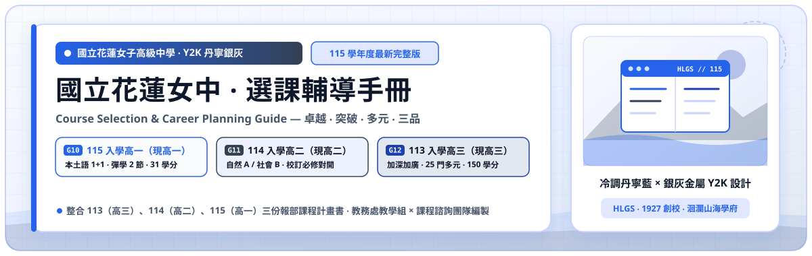
</picture>

 

  

<!-- 視覺風格下拉選單 (GitHub 原生 Details 下拉選單，純 SVG 圖示) -->

  
 <b>視覺風格選擇（點擊展開下拉選單 ── 目前主題：Y2K 丹寧銀灰 (Cyber Denim)）</b>

   
  <table>
    <thead>
      <tr>
        <th align="left">主題編號與名稱</th>
        <th align="left">風格定位與色系設計</th>
        <th align="center">切換 GitHub 手冊版</th>
        <th align="center">開啟響應式互動網頁版</th>
      </tr>
    </thead>
    <tbody>
      <tr>
        <td><b>01. 洄瀾太平洋 (Pacific Horizon)</b></td>
        <td>太平洋黑潮海藍 × 霧青現代編輯誌（預設主題）</td>
        <td align="center"></td>
        <td align="center"><a href="https://group01-hlgs.github.io/course-selection-guide/?theme=ocean">開啟網頁版</a></td>
      </tr>
      <tr>
        <td><b>02. 經典圖鑑風（古籍典藏）</b></td>
        <td>宣紙溫潤米白底色 × 古銅棕書籤 × 古籍之美細框與七大篇章向量圖鑑</td>
        <td align="center"></td>
        <td align="center"><a href="https://group01-hlgs.github.io/course-selection-guide/?theme=atlas">開啟網頁版</a></td>
      </tr>
      <tr>
        <td><b>03. Y2K 丹寧銀灰 (Cyber Denim)</b></td>
        <td>冷調丹寧靛藍 × 銀灰金屬質感設計</td>
        <td align="center"></td>
        <td align="center"><a href="https://group01-hlgs.github.io/course-selection-guide/?theme=denim">開啟網頁版</a></td>
      </tr>
      <tr>
        <td><b>04. 文青獨立雜誌 (Indie Zine)</b></td>
        <td>暖調原漿紙感 × 濃縮咖啡文青排版</td>
        <td align="center"></td>
        <td align="center"><a href="https://group01-hlgs.github.io/course-selection-guide/?theme=zine">開啟網頁版</a></td>
      </tr>
      <tr>
        <td><b>05. 縱谷松針森系 (Valley Pine)</b></td>
        <td>花東縱谷冷杉 × 礦石灰綠自然極簡</td>
        <td align="center"></td>
        <td align="center"><a href="https://group01-hlgs.github.io/course-selection-guide/?theme=pine">開啟網頁版</a></td>
      </tr>
      <tr>
        <td><b>06. 極簡黑白</b></td>
        <td>建築感純粹黑白 × 高對比現代資訊設計</td>
        <td align="center"></td>
        <td align="center"><a href="https://group01-hlgs.github.io/course-selection-guide/?theme=mono">開啟網頁版</a></td>
      </tr>
    </tbody>
  </table>

 

<!-- 左側三屆選課重點快篩 ＋ 右側章節條目導覽（雙欄對照佈局，章節條目固定於右側） -->
<table>
  <thead>
    <tr>
      <th width="46%" align="left"> 章節條目導覽（左側快速跳轉目錄）</th>
      <th width="54%" align="left"> 115 學年度三屆選課快篩 ＆ 互動工具入口</th>
    </tr>
  </thead>
  <tbody>
    <tr>
      <td valign="top">
        
<b>點擊左側章節條目直接跳轉至對應段落：</b>

        <ul>
          <li><b><a href="#radar">卷首｜115 三個年級選課速查雷達</a></b> 
            <a href="#g1-radar">115高一</a> ‧ <a href="#g2-radar">114高二</a> ‧ <a href="#g3-radar">113高三</a> ‧ <a href="#cross-cohort-diff">跨屆變動總表</a>
          </li>
          <li><b><a href="#ch1">壹、關於花女 — 願景、花女五力與校訂必修</a></b> 
            <a href="#ch1-1">一、學校願景</a> ‧ <a href="#ch1-2">二、花女五力</a> ‧ <a href="#ch1-3">三、校訂必修(普/資/美)</a>
          </li>
          <li><b><a href="#ch2">貳、三年將會走過的痕跡 — 課程地圖與畢業檢核</a></b> 
            <a href="#ch2-1">一、課程介紹</a> ‧ <a href="#ch2-2">二、課程架構</a> ‧ <a href="#ch2-3">三、班群介紹</a> ‧ <a href="#ch2-4">四、各班群課程地圖</a> ‧ <a href="#ch2-5">五、轉組學分對照</a> ‧ <a href="#ch2-6">六、畢業條件檢核表</a>
          </li>
          <li><b><a href="#ch3">參、決定自己的課程 — 選組、數A/數B、多元與社團</a></b> 
            <a href="#ch3-1">一、自然/社會與數A/B</a> ‧ <a href="#ch3-2">二、多元選修清單</a> ‧ <a href="#ch3-3">三、彈性與自主學習</a> ‧ <a href="#ch3-4">四、34個社團一覽</a>
          </li>
          <li><b><a href="#ch4">肆、對於未來的想像 — 生涯規劃與十八學群</a></b> 
            <a href="#ch4-0">生涯金三角</a> ‧ <a href="#ch4-1">一、性向與興趣測驗</a> ‧ <a href="#ch4-2">二、環境因素</a> ‧ <a href="#ch4-3">三、十八學群對應</a>
          </li>
          <li><b><a href="#ch5">伍、築夢踏實 — 學習歷程檔案與多元升學管道</a></b> 
            <a href="#ch5-1">一、學習歷程認證7步驟</a> ‧ <a href="#ch5-2">二、學測X/分科Y範圍與四大升學管道</a>
          </li>
          <li><b><a href="#ch6">陸、一路上有人陪我 — 課程諮詢與重要期程</a></b> 
            <a href="#ch6-1">一、課諮金三角</a> ‧ <a href="#ch6-2">二、找對人</a> ‧ <a href="#ch6-3">三、三年規劃</a> ‧ <a href="#ch6-4">四、選課期程</a> ‧ <a href="#ch6-5">五、選組轉組</a> ‧ <a href="#ch6-6">六、預約課諮</a>
          </li>
          <li><b><a href="#ch7">柒、原來不是只有我不懂 — 學長姐 Q&amp;A 二十三問</a></b> 
            <a href="#ch7-1">課程疑惑篇</a> ‧ <a href="#ch7-2">學習歷程篇</a> ‧ <a href="#ch7-3">課程諮詢篇</a> ‧ <a href="#ch7-4">升學進路篇</a> ‧ <a href="#ch7-5">手冊發行資訊</a>
          </li>
        </ul>
      </td>
      <td valign="top">
        

          <b>國立花蓮女子高級中學 ‧ 115 選課輔導手冊</b> 
          目前風格：<b>Y2K 丹寧銀灰 (Cyber Denim)</b> ｜ 整合 113/114/115 三份最新報部課程計畫書
        

        

        
<b>依入學屆別一鍵定位當學期與未來學期重點：</b>

        <ul>
          <li><b><a href="#g1-radar">我是高一（115 入學新生）</a></b>：本土語改 <code>1+1</code> 學年課、彈學每週完整 2 節、每學期固定 31 學分、高一多元選修新增 6 門課。</li>
          <li><b><a href="#g2-radar">我是高二（114 入學高二）</a></b>：校訂必修《洄瀾之欣》(2) 與《職業探究與報導》(2) 對開、自然 A 公民/選生對開、社會 B 先修家政(2)。</li>
          <li><b><a href="#g3-radar">我是高三（113 入學高三）</a></b>：高三下無部定必修國英（全轉加深加廣）、週四下午 25 門跑班多元選修、150 學分畢業檢核。</li>
          <li><b><a href="#cross-cohort-diff">113 vs 114 vs 115 跨屆 10 大關鍵變動總表</a></b></li>
        </ul>
        

        
<b><a href="https://group01-hlgs.github.io/course-selection-guide/?theme=denim">啟動 GitHub Pages 響應式互動網頁版</a></b> 
          支援「<b>風格下拉選單</b>」、「<b>桌機左側常駐章節欄／小螢幕左邊界滑出章節抽屜</b>」、「年級快篩」與「182 應修 / 150 及格畢業學分即時試算儀表板」。
        

      </td>
    </tr>
  </tbody>
</table>

 <b>點此預覽：《花女選課經典圖鑑・古籍之美典藏風》七大篇章純向量 SVG 徽章圖鑑</b>（亦可由上方風格下拉選單切換至經典圖鑑風主題）

 

  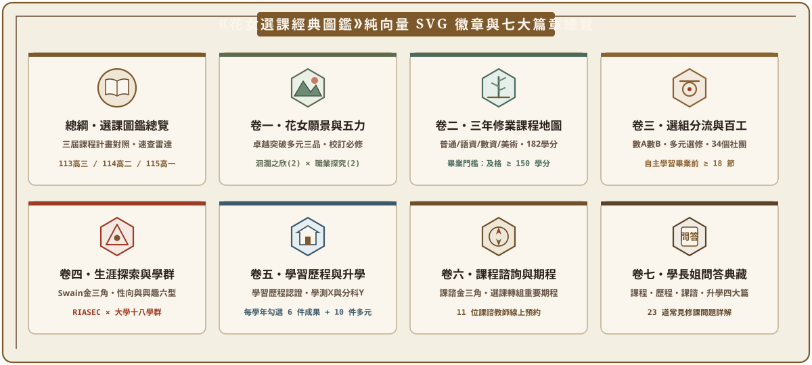

  

  

> **為什麼要先看這一區？**> 在 **115 學年度**同時在校的三個年級，分別適用 **115 學年度入學（現高一）**、**114 學年度入學（現高二）**、**113 學年度入學（現高三）**三份報部核定課程計畫書。為避免同學誤看不同屆別的學分配置，下方以自創純向量 SVG 圖卡與對照表整理「**當學期（115-1 / 115-2）**」與「**未來學期**」的所有關鍵重點！

### 【高一專區】115 學年度入學新生（Class of 115）

  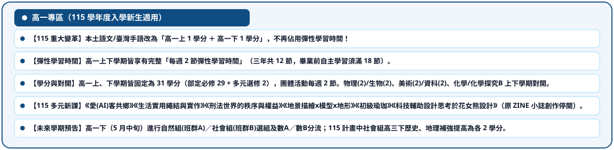

### 【高二專區】114 學年度入學高二（Class of 114）

  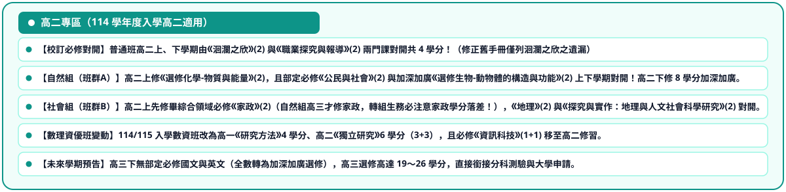

### 【高三專區】113 學年度入學高三（Class of 113）

  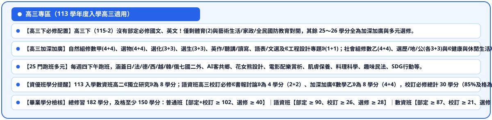

### 跨屆關鍵變動總表（113 入學高三 vs 114 入學高二 vs 115 入學高一）

|比較項目 |113 入學（現高三） |114 入學（現高二） |115 入學（現高一） |選課與修課提醒 |
|:--- |:--- |:--- |:--- |:--- |
|**本土語文／臺灣手語（部定必修 2 學分）**|高一上或高一下 **2 學分**（與彈性學習時間對開） |高一上或高一下 **2 學分**（與彈性學習時間對開） |**高一上 1 學分 ＋ 高一下 1 學分**（學年課，不再與彈學對開！） |**115 入學高一重大變革**：每學期固定 1 節本土語/手語 |
|**高一每學期修習總學分數**|一上 **30**學分 ／ 一下 **32**學分 |一上 **30**學分 ／ 一下 **32**學分 |一上 **31**學分 ／ 一下 **31**學分 |四個班群（普通/語資/數資/美術）115 入學高一每學期均為 **31 學分**|
|**團體活動時間（三年節數）**|高一上 3 節、其餘每學期 2 節（三年共 **17 節**） |高一上 3 節、其餘每學期 2 節（三年共 **17 節**） |六個學期皆為每週 **2 節**（三年共 **16 節**） |班會（週三第 5 節）＋ 社團活動（週三第 6、7 節） |
|**彈性學習時間（三年節數）**|一上 2 節、一下 1 節、高二高三各 2 節（三年共 **11 節**） |一上 2 節、一下 1 節、高二高三各 2 節（三年共 **11 節**） |六個學期皆為每週 **2 節**（三年共 **12 節**） |**115 入學高一上下學期皆有每週 2 節彈學**（畢業前自主學習須滿 18 節） |
|**普通班高二校訂必修（4 學分）**|《洄瀾之欣》(2) ＋《職業探究與報導》(2) 上下對開 |《洄瀾之欣》(2) ＋《職業探究與報導》(2) 上下對開 |《洄瀾之欣》(2) ＋《職業探究與報導》(2) 上下對開 |舊版手冊文字僅介紹《洄瀾之欣》，實際課程計畫為兩門對開共 4 學分 |
|**普通班社會組高三補強選修（歷史／地理）**|高三上 **1**學分 ＋ 高三下 **1**學分（共 2 學分） |高三上 **1**學分 ＋ 高三下 **1**學分（共 2 學分） |高三上 **2**學分 ＋ 高三下 **2**學分（共 4 學分） |115 入學社會組高三歷史、地理補強選修提高為每學期 2 學分 |
|**數理資優班校訂必修（24 學分）配置**|高一《研究方法》**2**學分（一下） 高二《獨立研究》**8**學分（4+4） |高一《研究方法》**4**學分（2+2） 高二《獨立研究》**6**學分（3+3） |高一《研究方法》**4**學分（2+2） 高二《獨立研究》**6**學分（3+3） |校訂必修總學分維持 **24 學分**（及格門檻 85% = **21 學分**） |
|**數理資優班部定必修《資訊科技》(2)**|高一修習（1+1） |**高二修習（1+1）**|**高二修習（1+1）**|114、115 入學數資班將資訊科技移至高二，以配合高一研究方法(2+2) |
|**語文資優班高三《書報討論》與《數學乙》**|校訂《書報討論》**4**學分（2+2） 加深加廣《數學乙》**8**學分（4+4） |校訂《書報討論》**4**學分（2+2） 加深加廣《數學乙》**8**學分（4+4） |校訂《書報討論》**4**學分（2+2） 加深加廣《數學乙》**8**學分（4+4） |修正舊手冊誤植：語資校訂必修實為 **30 學分**（85%及格為 **26 學分**） |
|**高一多元選修新增／調整課程**|含《ZINE 小誌創作》等 |含《ZINE 小誌創作》等 |**新增 6 門**：《愛(AI)客共鄉》《生活實用繩結與實作》《刑法世界的秩序與權益》《地景描繪x模型x地形》《初級瑜珈》《科技輔助設計思考於花女熊設計》（停開 ZINE 小誌創作） |高一上學期由學校分發或選填，高一下學期不得重複修習同門課 |

  

  

  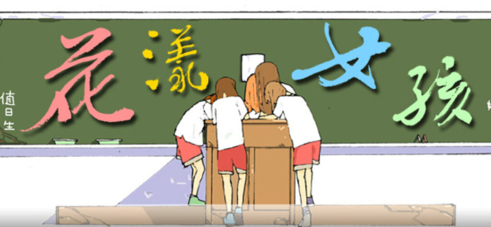

### 一、學校願景（卓越 ‧ 突破 ‧ 多元 ‧ 三品）

**國立花蓮女子高級中學**創立於民國 16 年（1927 年），為花蓮地區唯一一所國立女子高中。學校坐落於花蓮市美崙溪口南側、依附花崗山台地，東臨浩瀚太平洋、西倚雄偉中央山脈。在山海環抱的優美環境中，花女以**「卓越、突破、多元、三品」**為四大發展方向，致力於**建構「學習型學校」**，並**邁向「全是贏家的學校」**：

|願景核心 |內涵說明 |學校發展目標 |
|:---: |:--- |:--- |
| **卓越**|**培育具備全人發展、全能啟發、全德涵養的新世紀優質公民**|激發多元潛能，兼具學術涵養與公民素養 |
| **突破**|**建構具備教師專業、教學創新、行政效能的活力團隊**|跨領域社群共備、PBL 專題探究與數位創新教學 |
| **多元**|**以資源分享、社區意識、共存共榮理念整合多元化的文教資源**|結合在地海洋、人文、大學與國際姊妹校資源 |
| **三品**|**推動行為有品德、教學有品質、生活有品味的「三品」教育**|實踐行為有品德、教學有品質、生活有品味的現代公民素養 |

  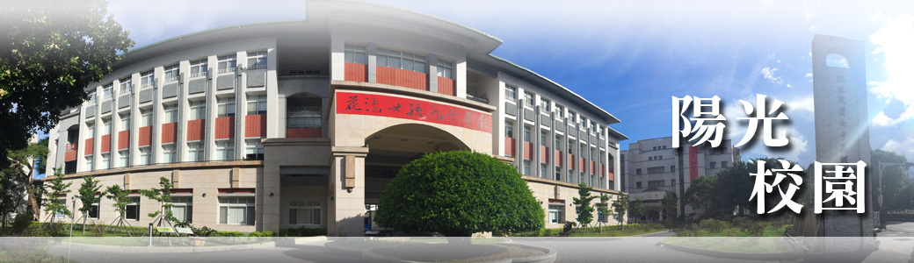

---

### 二、學生圖像（花女五力 Core Competencies）

本校依循十二年國教總綱「自發、互動、共好」理念，結合學校願景，擘劃出花女學生的五大核心能力——**「思考力、心美力、溝通力、實踐力、超越力」（花女五力）**：

  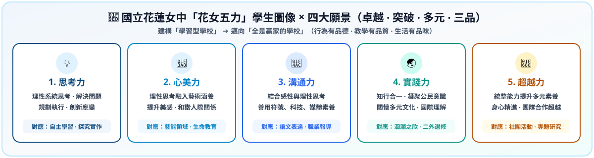

 <b>點擊展開檢視：手冊原廠「花女五力學生圖像」圖檔與五力完整說明表</b>

 

  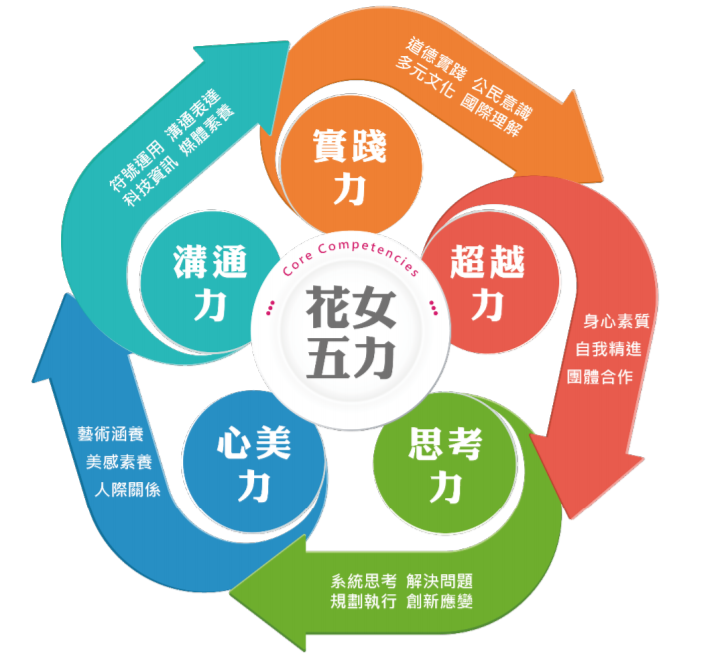

|花女五力 |手冊原廠圖示 |核心素養與能力內涵 |對應課程與校內活動 |
|:---: |:---: |:--- |:--- |
|**1. 思考力**| |**理性系統思考、解決問題、規劃執行、創新應變。**|自然科學探究與實作、社會探究、數學專題、自主學習計畫 |
|**2. 心美力**| |**將理性思考融入藝術涵養、提升美感素養、增進和諧人際關係。**|音樂、美術、藝術生活、生命教育、校園美感策展 |
|**3. 溝通力**| |**結合感性與理性思考，善用符號、科技、媒體素養以達有效溝通。**|國語文、英語文、本土語/臺灣手語、第二外語、職業探究與報導 |
|**4. 實踐力**| |**知行合一、凝聚公民意識、關懷多元文化、國際理解。**|校訂必修《洄瀾之欣》、SDG 永續發展行動、公民倡議、服務性社團 |
|**5. 超越力**| |**統整上述能力以提升多元素養，追求身心素質自我精進，善用團隊合作力量，達成自我超越。**|獨立研究、畢業專題製作、34 個多元社團、運動會與班際競賽 |

---

### 三、校訂必修課程（普通班 ‧ 語文資優班 ‧ 數理資優班 ‧ 美術資優班）

#### 1. 普通班校訂必修（高二修習，共 4 學分，上下學期對開）

>  **最新報部課程計畫重要核對說明**：
> 舊版手冊文字僅詳述《洄瀾之欣》(2 學分)，但依據 **113、114、115 學年度報部課程計畫書**，普通班（含自然組班群 A、社會組班群 B）於**高二上、下學期共有兩門校訂必修（合計 4 學分）採上下學期對開**：
> 1. **《洄瀾之欣》（2 學分）**
> 2. **《職業探究與報導》（2 學分）**

- **《洄瀾之欣》（2 學分）**：
  花蓮女中位於花蓮市美崙溪口南側，依附花崗山台地，東面太平洋，西倚中央山脈，坐擁豐富自然生態與多元人文歷史。本課程由跨領域教師團隊共同開發，分為三大核心主題模組：
  1. **海洋產業文化**：踏查花蓮港、七星潭定置漁場、黑潮鏢旗魚文化與海洋文學。
  2. **海岸地形**：實察花東海岸板塊碰撞、海階地形、七星潭礫灘與美崙溪口演變。
  3. **海洋資源**：探討海洋生態保育、太平洋黑潮資源永續與在地環境議題。
  課程採用 **PBL（Problem-Based Learning 問題導向學習）**模式，引導學生透過實地踏查、小組討論、海報策展與專題發表，全面培養「思考、心美、溝通、實踐、超越」花女五力！
- **《職業探究與報導》（2 學分）**：
  結合生涯探索、人物訪談、媒體識讀與紀實寫作，引導高二學生針對感興趣的學群與職人進行田野訪談與專題報導撰寫，產出極具個人特色的「課程學習成果」作品。

|圖 1-1：《洄瀾之欣》學生五力雷達圖與課程架構 |圖 1-2：《洄瀾之欣》110-2 票選得獎作品展實況 |
|:---: |:---: |
|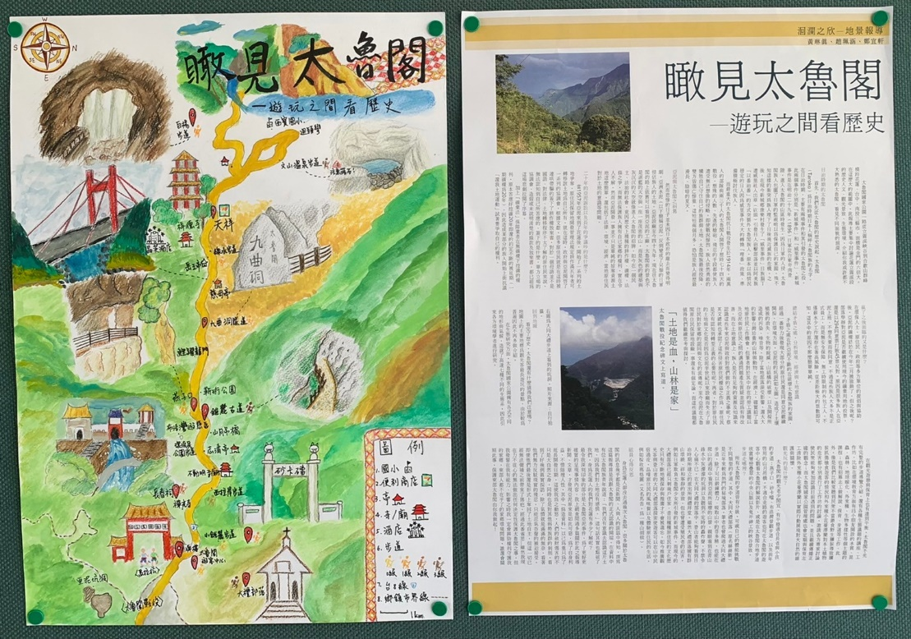 | |
#### 2. 語文資優班、數理資優班、美術資優班之校訂必修（特殊需求領域／專長領域）

|班別 |校訂必修總學分 |高一上 |高一下 |高二上 |高二下 |高三上 |高三下 |跨屆重點說明 |
|:--- |:---: |:--- |:--- |:--- |:--- |:--- |:--- |:--- |
|**普通班**|**4 學分**|— |— |洄瀾之欣(2)／職業探究與報導(2) 對開 |洄瀾之欣(2)／職業探究與報導(2) 對開 |— |— |高二上下學期對開，各修 2 學分 |
|**語文資優班** *(特殊需求領域)* |**30 學分**|古典文學概論(2) 論文寫作(2) 聽力與口語訓練(2) |論文寫作(2) 閱讀寫作(2) 聽力與口語訓練(2) |獨立研究(3) 現代文學概論(2) 經典導讀(2) |獨立研究(3) 現代文學概論(2) 經典導讀(2) |**書報討論(2)**|**書報討論(2)**|**113/114/115 三屆皆為 30 學分**（高三書報討論為 2+2，舊手冊誤植為 3+3 共 32 學分） |
|**數理資優班** *(113入學 現高三)* |**24 學分**|科學閱讀(2) |生活與化學(2) **研究方法(2)**|**獨立研究(4)** 科學探究(2) 數學專題I(2) |**獨立研究(4)** 數學專題I(2) |數學專題II(2) |數學專題II(2) |113 入學高一研究方法 2 學分、高二獨立研究 8 學分(4+4) |
|**數理資優班** *(114/115入學 現高二/高一)* |**24 學分**|科學閱讀(2) **研究方法(2)**|生活與化學(2) **研究方法(2)**|**獨立研究(3)** 科學探究(2) 數學專題I(2) |**獨立研究(3)** 數學專題I(2) |數學專題II(2) |數學專題II(2) |**114/115 入學改制**：高一研究方法改為 4 學分(2+2)，高二獨立研究改為 6 學分(3+3) |
|**美術資優班** *(特殊需求領域)* |**8 學分** *(另加藝才專長必修 60 學分)* |書法1(1) |書法2(1) |造形藝術(1) |— |書法3(1) 彩繪技法1(2) |彩繪技法2(2) |藝術才能專長領域必修 60 學分詳見下方美術班課程地圖 |

  

  

  

### 一、課程介紹（部定必修 ‧ 校訂必修 ‧ 選修 ‧ 團體活動 ‧ 彈性學習）

十二年國教高級中等學校課程分為**「部定課程」**與**「校訂課程」**兩大類：
1. **部定必修課程**：由國家統一規劃，養成學生基本學力與核心素養，所有高中生皆須修習（包含高一高二「自然科學探究與實作 A/B」）。
2. **校訂必修課程**：由學校依願景與在地特色發展之必修課（普通班為高二《洄瀾之欣》2 學分＋《職業探究與報導》2 學分；資優班與美術班為特殊需求領域專題課程）。
3. **選修課程**：
   - **加深加廣選修**：由教育部研修課綱，延伸部定必修科目，滿足學生升學學群進路與分科測驗需求（高二、高三依自然組／社會組分流修習及高三跑班選修）。
   - **多元選修**：由各校教師依專長開設之跨領域、第二外語、通識或實作課程（每學期至少開出 1.2 倍以上班級數供學生跨班選修）。
   - **補強性選修**：因應學生學習差異與銜接需求開設（如高二自然組補強物理/化學，高三社會組英/數/歷/地/公補強選修）。
4. **團體活動時間**：包含每週三第 5 節「班級活動／週會講座」與第 6、7 節「社團活動」（每學期 2～3 節，不計入畢業學分但為必修課程）。
5. **彈性學習時間**：固定於每週五第 3、4 節（每週 1～2 節），包含**自主學習（畢業前至少須修習 18 節以上）**、選手培訓、充實（增廣）／補強性教學（微課程）及學校特色活動。

---

### 二、課程架構總表（普通班 ‧ 語資班 ‧ 數資班 ‧ 美術班 113/114/115 跨屆完整對照）

>  **三年修習總學分數皆為 182 學分（最低畢業及格門檻為 150 學分）**。注意 **115 入學高一**因本土語改為一上 1 學分＋一下 1 學分，故團體活動改為三年 **16 節**（每學期固定 2 節）、彈性學習改為三年 **12 節**（每學期固定 2 節），三年總上課節數維持 **210 節（每週 35 節 × 6 學期）**！

|班別 |部定必修 |校訂必修 |加深加廣選修 |多元選修 |補強選修 |**修習總學分**|團體活動節數 *(113‧114 / **115**)* |彈性學習節數 *(113‧114 / **115**)* |**三年總節數**|
|:--- |:---: |:---: |:---: |:---: |:---: |:---: |:---: |:---: |:---: |
|**普通班（班群 A 自然組）**|**118**|**4**|**50***(或48)* |**10**|0 *(或2)* |**182 學分**|17 節 / **16 節**|11 節 / **12 節**|**210 節**|
|**普通班（班群 B 社會組）**|**118**|**4**|**42～48**|**10**|**2～8**|**182 學分**|17 節 / **16 節**|11 節 / **12 節**|**210 節**|
|**語文資優班**|**112**|**30**|**34**|**6**|0 |**182 學分**|17 節 / **16 節**|11 節 / **12 節**|**210 節**|
|**數理資優班**|**108**|**24**|**44**|**6**|0 |**182 學分**|17 節 / **16 節**|11 節 / **12 節**|**210 節**|
|**美術資優班**|**86**+ **60***(專長)* |**8***(特需)* |**22**|**6**|0 |**182 學分**|17 節 / **16 節**|11 節 / **12 節**|**210 節**|
---

### 三、班群介紹（普通班 A/B 班群與三類特殊班）

本校共設有普通班（高一不分群，高二起分為 **班群 A 自然組**與 **班群 B 社會組**）以及三個特殊班級（**語文資優班、數理資優班、美術資優班**）：

|班群／班別 |適性發展方向與對應大學十八學群 |數學版本配置 |核心加深加廣選修配置 |
|:--- |:--- |:---: |:--- |
|**普通班－班群 A（自然組）**|適合工程、資訊、數理化、醫藥衛生、生命科學、生物資源、地球與環境、建築設計等理工生醫農學群（兼顧商管跨考需求） |高二：**數學 A (4+4)** 高三：**數學甲 (4+4)**|選修物理（力學一、力學二與熱學、波動光及聲音、電磁現象一、電磁現象二與量子現象，共10學分）、選修化學（共8學分）、選修生物（共8學分）、選修地科（2學分）、工程設計專題（2學分） |
|**普通班－班群 B（社會組）**|適合文史哲、外語、法政、社會心理、大眾傳播、教育、管理、財經、遊憩運動、藝術等文科與商管學群 |高二：**數學 B 或 數學 A (4+4)** *(跑班分組上課)* 高三：**數學乙 (4+4)**或補強 |歷史學探究(2)、族群性別與國家的歷史(3)、科技環境與藝術的歷史(3)；地理探究(2)、社會環境議題(3)、空間資訊科技(3)；公共議題與社會探究(2)、現代社會與經濟(3)、民主政治與法律(3)；創新生活與家庭(2)、健康與休閒生活(2) |
|**語文資優班**|適合外語、文史哲、法政、傳播、教育、國際關係、社會心理、商管等人文社會頂尖科系 |高二：**數學 B (4+4)** 高三：**數學乙 (4+4)**|除 30 學分特殊需求領域專題（古典/現代文學、論文寫作、聽力口語、獨立研究、經典導讀、書報討論）外，高二高三修習完整英、國、歷、地、公加深加廣共 34 學分 |
|**數理資優班**|適合醫牙藥、電機資訊、物理、化學、數學、生命科學、材料工程等頂尖理工生醫科系 |高二：**數學 A (4+4)** 高三：**數學甲 (4+4)**|除 24 學分特殊需求領域專題（科學閱讀、生活與化學、研究方法、獨立研究、科學探究、數學專題I/II）外，高二高三修習完整物、化、生、地科、數甲加深加廣共 44 學分 |
|**美術資優班**|適合美術、視覺傳達、工業設計、建築與景觀、數位媒體、藝術史、藝術行政與文創產業學系 |高二：**數學 B (3+3)** 高三：加深加廣國/英/社 |藝術才能專長必修 60 學分（素描18、水墨12、水彩8、基本設計4、版畫4、創意表現4、藝術概論3、畢業專題製作3、藝術史2、色彩學1、藝術鑑賞1）＋ 特殊需求 8 學分（書法、造形藝術、彩繪技法） |
---

### 四、各班群課程地圖（113 高三 ‧ 114 高二 ‧ 115 高一 完整六學期學分數對照表）

#### 表 2-1：普通班【班群 A（自然組）】六學期課程學分數表

>  **自然組看表重點**：
> 1. **115 入學高一**本土語文／臺灣手語為 **一上 1 學分 ＋ 一下 1 學分**，因此高一上下學期皆為 **31 學分**、團體活動 2 節、彈性學習 2 節（113、114 入學為一上 30 學分／一下 32 學分）。
> 2. **高二上下學期特殊對開**：部定必修 **《公民與社會》(2)**與加深加廣選修 **《選修生物-動物體的構造與功能》(2)**採上下學期對開！校訂必修 **《洄瀾之欣》(2)**與 **《職業探究與報導》(2)**亦採上下學期對開！
> 3. **高三下無部定必修國文、英文**，全數轉為加深加廣選修（語文表達2、各類文學選讀2、英語聽講2、英文閱讀與寫作2）。

|課程類別 |領域／科目名稱 |總學分 |高一上 |高一下 |高二上 |高二下 |高三上 |高三下 |備註與對開說明 |
|:--- |:--- |:---: |:---: |:---: |:---: |:---: |:---: |:---: |:--- |
|**部定必修**|**國語文**|**20**|4 |4 |4 |4 |4 |— |高三下改修加深加廣國文(4) |
|部定必修 |**英語文**|**18**|4 |4 |4 |4 |2 |— |高三上另修英文作文(2)，高三下改修聽講(2)+讀寫(2) |
|部定必修 |**本土語文／臺灣手語**|**2**|**1***(或0)* |**1***(或2)* |— |— |— |— |**115入學為 1+1**；113/114入學為單學期 2 學分與彈學對開 |
|部定必修 |**數學**|**16**|4 |4 |4 *(數A)* |4 *(數A)* |— |— |高二自然組修習**數學 A**|
|部定必修 |**歷史**|**6**|2 |2 |2 *(或0)* |0 *(或2)* |— |— |高二歷史(2)與地理(2)上下學期對開 |
|部定必修 |**地理**|**6**|2 |2 |0 *(或2)* |2 *(或0)* |— |— |高二歷史(2)與地理(2)上下學期對開 |
|部定必修 |**公民與社會**|**6**|2 |2 |**2 *(或0)***|**0 *(或2)***|— |— |**高二與加深加廣《選修生物-動物體》(2)上下對開**|
|部定必修 |**物理***(含探究A)* |**4**|2 *(或0)* |0 *(或2)* |2 *(含探究A)* |— |— |— |高一物理(2)與生物(2)上下對開 |
|部定必修 |**化學***(含探究B)* |**4**|2 |2 |— |— |— |— |高一化學(2)與化學-探究與實作B(2)上下對開 |
|部定必修 |**生物**|**2**|0 *(或2)* |2 *(或0)* |— |— |— |— |高一物理(2)與生物(2)上下對開 |
|部定必修 |**地球科學**|**2**|— |— |2 |— |— |— |自然組於高二上修習地球科學(2) |
|部定必修 |**音樂**|**4**|1 |1 |1 |1 *(或0)* |— |— |高二音樂/美術配置 |
|部定必修 |**美術**|**4**|2 *(或0)* |0 *(或2)* |1 |1 *(或2)* |— |— |高一美術(2)與資訊科技(2)上下對開 |
|部定必修 |**藝術生活**|**2**|— |— |— |— |2 *(或0)* |0 *(或2)* |高三與家政(2)上下學期對開 |
|部定必修 |**生命教育 ／ 生涯規劃**|**2**|1 *(生命)* |1 *(生涯)* |— |— |— |— |高一上生命教育(1)、高一下生涯規劃(1) |
|部定必修 |**家政**|**2**|— |— |— |— |**0 *(或2)***|**2 *(或0)***|**自然組高三才修家政(2)**（與藝術生活對開） |
|部定必修 |**生活科技 ／ 資訊科技**|**4**|0 *(或2)* |2 *(或0)* |2 *(或0)* |0 *(或2)* |— |— |高一資科(2)與美術對開；高二生科(2)與健護對開 |
|部定必修 |**健康與護理**|**2**|— |— |0 *(或2)* |2 *(或0)* |— |— |高二與生活科技(2)上下對開 |
|部定必修 |**體育**|**12**|2 |2 |2 |2 |2 |2 |每學期固定 2 學分 |
|部定必修 |**全民國防教育**|**2**|— |— |— |— |1 |1 |高三上下學期各 1 學分 |
|**校訂必修**|**洄瀾之欣 ／ 職業探究與報導**|**4**|— |— |**2**|**2**|— |— |**兩門課於高二上下學期對開（共 4 學分）**|
|**加深加廣**|**國語文加深加廣**|**4**|— |— |— |— |— |**4**|高三下：《語文表達與傳播應用》(2)＋《各類文學選讀》(2) |
|加深加廣 |**英語文加深加廣**|**6**|— |— |— |— |**2**|**4**|高三上：《英文作文》(2)；高三下：《英語聽講》(2)＋《英文閱讀與寫作》(2) |
|加深加廣 |**數學甲**|**8**|— |— |— |— |**4**|**4**|高三上下學期各 4 學分 |
|加深加廣 |**選修物理***(5門完整)* |**10**|— |— |— |**2**|**4**|**4**|二下：力學一(2)；三上：力學二與熱學(2)+波動光及聲音(2)；三下：電磁一(2)+電磁二與量子(2) |
|加深加廣 |**選修化學***(4門完整)* |**8**|— |— |**2**|**2**|**2***(或3)* |**2***(或3)* |二上：物質與能量(2)；二下：物質構造與反應速率(2)；高三：化學反應與平衡一/二、有機化學與應用科技 |
|加深加廣 |**選修生物***(4門完整)* |**8**|— |— |**0 *(或2)***|**2 *(或0)***|**3**|**3**|二上或二下：動物體的構造與功能(2，與公民對開)；高三：細胞與遺傳、生命的起源與植物體、生態演化及生物多樣性 |
|加深加廣 |**選修地球科學**|**2**|— |— |— |**2**|— |— |二下：《大氣、海洋及天文》(2) |
|加深加廣 |**工程設計專題***(科技領域)* |**2**|— |— |— |— |**1**|**1**|高三上下學期各 1 學分（另提供科技/健體/藝術加深加廣與補強選修跑班） |
|**多元選修**|**跨班多元選修**|**10**|**2**|**2**|— |**2***(或補強)* |**2**|**2**|高一(2+2)、高二下(2，或選補強物/化)、高三(2+2) |
| **合計**|**每學期修習總學分**|**182**|**31***(30)* |**31***(32)* |**31**|**31**|**29**|**29**|括號內為 113、114 入學高一上下學期學分數 |
| **活動/彈學**|**團體活動 ／ 彈性學習節數**|**28節**|**2 / 2***(3/2)* |**2 / 2***(2/1)* |**2 / 2**|**2 / 2**|**2 / 2**|**2 / 2**|每週總上課節數皆為 **35 節**|
---

#### 表 2-2：普通班【班群 B（社會組）】六學期課程學分數表

>  **社會組看表重點**：
> 1. **高二數學分組跑班**：社會組同學高二可依目標校系選擇修習 **《數學 B》(4+4)**或 **《數學 A》(4+4)**！
> 2. **高二上先修《家政》(2)**：社會組於**高二上**即修畢部定必修《家政》(2)，自然組則於高三才修家政（高二轉組時請特別留意此學分差異）。
> 3. **高二對開組合**：《地理》(2) 與加深加廣《探究與實作：地理與人文社會科學研究》(2) 上下對開；《物理-探究A》(2) 與《地球科學》(2) 上下對開；校訂必修《洄瀾之欣》(2) 與《職業探究與報導》(2) 上下對開。
> 4. **115 入學高三補強選修變動**：113、114 入學社會組高三歷史、地理補強選修為 **1+1 學分**；**115 入學起提高為 2+2 學分**！

|課程類別 |領域／科目名稱 |總學分 |高一上 |高一下 |高二上 |高二下 |高三上 |高三下 |備註與對開說明 |
|:--- |:--- |:---: |:---: |:---: |:---: |:---: |:---: |:---: |:--- |
|**部定必修**|**國語文**|**20**|4 |4 |4 |4 |4 |— |高三下改修加深加廣國文(6) |
|部定必修 |**英語文**|**18**|4 |4 |4 |4 |2 |— |高三上另修英文作文(2)，高三下改修聽講(2)+讀寫(2) |
|部定必修 |**本土語文／臺灣手語**|**2**|**1***(或0)* |**1***(或2)* |— |— |— |— |**115入學為 1+1**；113/114入學為單學期 2 學分 |
|部定必修 |**數學**|**16**|4 |4 |4 *(數B/數A)* |4 *(數B/數A)* |— |— |社會組高二可選修 **數學 B**或 **數學 A**|
|部定必修 |**歷史**|**6**|2 |2 |2 |— |— |— |高二上修畢必修歷史(2)，高二下修歷史學探究(2) |
|部定必修 |**地理**|**6**|2 |2 |**2 *(或0)***|**0 *(或2)***|— |— |**高二與加深加廣《地理探究》(2)上下對開**|
|部定必修 |**公民與社會**|**6**|2 |2 |2 |— |— |— |高二上修畢必修公民(2)，高二下修公共議題探究(2) |
|部定必修 |**物理***(含探究A)* |**4**|2 *(或0)* |0 *(或2)* |2 *(或0)* |0 *(或2)* |— |— |高二《物理-探究A》(2)與《地球科學》(2)上下對開 |
|部定必修 |**化學***(含探究B)* |**4**|2 |2 |— |— |— |— |高一修畢化學(2)與化學-探究B(2) |
|部定必修 |**生物**|**2**|0 *(或2)* |2 *(或0)* |— |— |— |— |高一與物理(2)上下對開 |
|部定必修 |**地球科學**|**2**|— |— |0 *(或2)* |2 *(或0)* |— |— |高二與《物理-探究A》(2)上下對開 |
|部定必修 |**音樂 ／ 美術**|**8**|1+2*(或0)* |1+0*(或2)* |0+2 |1+1 |— |— |音樂 4 學分 ＋ 美術 4 學分 |
|部定必修 |**藝術生活**|**2**|— |— |— |— |2 *(或0)* |0 *(或2)* |高三與全民國防教育(2)上下學期對開 |
|部定必修 |**生命教育 ／ 生涯規劃**|**2**|1 *(生命)* |1 *(生涯)* |— |— |— |— |高一上生命教育(1)、高一下生涯規劃(1) |
|部定必修 |**家政**|**2**|— |— |**2**|— |— |— |**社會組高二上即修畢家政(2)！**|
|部定必修 |**生活科技 ／ 資訊科技**|**4**|0 *(或2)* |2 *(或0)* |2 *(或0)* |0 *(或2)* |— |— |高一資科與美術對開；高二生科與健護對開 |
|部定必修 |**健康與護理**|**2**|— |— |0 *(或2)* |2 *(或0)* |— |— |高二與生活科技(2)上下對開 |
|部定必修 |**體育**|**12**|2 |2 |2 |2 |2 |2 |每學期固定 2 學分 |
|部定必修 |**全民國防教育**|**2**|— |— |— |— |0 *(或2)* |2 *(或0)* |高三與藝術生活(2)上下對開 |
|**校訂必修**|**洄瀾之欣 ／ 職業探究與報導**|**4**|— |— |**2**|**2**|— |— |**兩門課於高二上下學期對開（共 4 學分）**|
|**加深加廣**|**國語文加深加廣**|**8**|— |— |— |— |**2**|**6**|三上：《國學常識》(2)；三下：《語文表達》(2)＋《各類文學選讀》(2)＋《專題閱讀與研究》(2) |
|加深加廣 |**英語文加深加廣**|**6**|— |— |— |— |**2**|**4**|三上：《英文作文》(2)；三下：《英語聽講》(2)＋《英文閱讀與寫作》(2) |
|加深加廣 |**數學乙***(或跑班補強)* |**8***(或0)* |— |— |— |— |**4**|**4**|與高三補強性選修（英/數/歷/地/公）跑班修習 |
|加深加廣 |**歷史加深加廣***(3門)* |**8**|— |— |— |**2**|**3**|**3**|二下：《歷史學探究》(2)；三上：《族群、性別與國家的歷史》(3)；三下：《科技、環境與藝術的歷史》(3) |
|加深加廣 |**地理加深加廣***(3門)* |**8**|— |— |**0 *(或2)***|**2 *(或0)***|**3**|**3**|二上或二下：《地理與人文社會科學研究》(2，與地理對開)；三上：《社會環境議題》(3)；三下：《空間資訊科技》(3) |
|加深加廣 |**公民加深加廣***(3門)* |**8**|— |— |— |**2**|**3**|**3**|二下：《公共議題與社會探究》(2)；三上：《現代社會與經濟》(3)；三下：《民主政治與法律》(3) |
|加深加廣 |**綜合／健體加深加廣**|**4**|— |— |— |**2**|**1**|**1**|二下：《創新生活與家庭》(2)；三上/三下：《健康與休閒生活》(1+1) |
|**多元/補強**|**多元選修 ＋ 補強性選修**|**10**|**2**|**2**|— |— |**2***(+補強)* |**2***(+補強)* |高三補強跑班：英語文(4+4)、數學(4+4)、公民(2+2)、歷史與地理(113/114為1+1，**115為2+2**) |
| **合計**|**每學期修習總學分**|**182**|**31***(30)* |**31***(32)* |**31**|**31**|**29**|**29**|三年總修習 182 學分 |
---

#### 表 2-3：語文資優班 ‧ 數理資優班 ‧ 美術資優班 課程地圖重點總覽

 <b>點擊展開／收合：三大特殊班（語資班、數資班、美術班）六學期完整課程配置表</b>

 

##### 1 語文資優班（部定必修 112 ＋ 校訂特殊需求 30 ＋ 加深加廣 34 ＋ 多元選修 6 ＝ 182 學分）
- **部定必修（112 學分）**：國文(20)、英文(18)、本土語/手語(2，**115入學為一上1+一下1**)、數學(16，高二修數B)、歷史(6)、地理(6)、公民(6)、物理(2)、化學(2)、生物(2)、地科(2)、音樂(4)、美術(4)、藝術生活(2)、生命教育(1)、生涯規劃(1)、家政(2)、生活科技(2)、資訊科技(2)、健康與護理(2)、體育(8，高一高二各2)、全民國防教育(2)。
- **校訂必修－特殊需求領域（30 學分）**：
  - **高一（12 學分）**：《古典文學概論》(一上2)、《閱讀寫作》(一下2)、《論文寫作》(一上2+一下2)、《聽力與口語訓練》(一上2+一下2)。
  - **高二（14 學分）**：《獨立研究》(二上3+二下3)、《現代文學概論》(二上2+二下2)、《經典導讀》(二上2+二下2)。
  - **高三（4 學分）**：《書報討論》(三上2+三下2)。
- **選修課程（40 學分＝加深加廣 34 ＋ 多元選修 6）**：
  - **高一**：多元選修（一上1+一下1，共2學分）。
  - **高二**：加深加廣《英語聽講》(二上1+二下1，共2學分)。
  - **高三上（16 學分）**：《國學常識》(2)、《英文閱讀與寫作》(2)、**《數學乙》(4)**、《族群、性別與國家的歷史》(2)、《社會環境議題》(2)、《現代社會與經濟》(2)、多元選修(2)。
  - **高三下（20 學分）**：《語文表達與傳播應用》(2)、《專題閱讀與研究》(2)、《英文閱讀與寫作》(2)、《英文作文》(2)、**《數學乙》(4)**、《科技、環境與藝術的歷史》(2)、《空間資訊科技》(2)、《民主政治與法律》(2)、多元選修(2)。

##### 2 數理資優班（部定必修 108 ＋ 校訂特殊需求 24 ＋ 加深加廣 44 ＋ 多元選修 6 ＝ 182 學分）
- **部定必修（108 學分）**：國文(20)、英文(18)、本土語/手語(2，**115入學為一上1+一下1**)、數學(16，高二修數A)、歷史(4)、地理(4)、公民(4)、物理(2)、化學(2)、生物(2)、地科(2)、音樂(4)、美術(4)、藝術生活(2)、生命教育(1)、生涯規劃(1)、家政(2)、生活科技(2)、**資訊科技(2，113入學於高一1+1修習，114/115入學改於高二1+1修習)**、健康與護理(2)、體育(8，高一高二各2)、全民國防教育(2)。
- **校訂必修－特殊需求領域（24 學分）**：
  - **高一**：《科學閱讀》(一上2)、《生活與化學》(一下2)、**《研究方法》**（113入學為一下2學分；**114/115入學為一上2+一下2共4學分**）。
  - **高二**：**《獨立研究》**（113入學為4+4共8學分；**114/115入學為3+3共6學分**）、《科學探究》(二上2)、《數學專題I》(二上2+二下2)。
  - **高三**：《數學專題II》(三上2+三下2，共4學分)。
- **選修課程（50 學分＝加深加廣 44 ＋ 多元選修 6）**：
  - **高一**：多元選修（一上2學分）。
  - **高二上（4 學分）**：《選修物理-力學一》(2)、《選修化學-物質與能量》(2)。
  - **高二下（6 學分）**：《選修物理-力學二與熱學》(2)、《選修化學-物質構造與反應速率》(2)、《選修生物-細胞與遺傳》(2)。
  - **高三上（18 學分）**：《英文作文》(2)、《數學甲》(4)、《選修物理-波動、光及聲音》(2)+《電磁現象一》(2)、《選修化學-化學反應與平衡一》(2)+《反應與平衡二》(1)、《選修生物-動物體的構造與功能》(2)+《生命的起源與植物體》(1)、多元選修(2)。
  - **高三下（20 學分）**：《語文表達與傳播應用》(2)、《英語聽講》(1)、《英文作文》(1)、《英文閱讀與寫作》(2)、《數學甲》(4)、《選修物理-電磁現象二與量子現象》(2)、《選修化學-反應與平衡二》(1)+《有機化學與應用科技》(2)、《選修生物-生命的起源與植物體》(1)+《生態、演化及生物多樣性》(2)、**《選修地球科學-大氣、海洋及天文》(2，114/115入學調整至三下)**、多元選修(2)。

##### 3 美術資優班（部定一般 86 ＋ 藝才專長必修 60 ＋ 校訂特需 8 ＋ 加深加廣 22 ＋ 多元 6 ＝ 182 學分）
- **藝術才能專長領域必修（60 學分）**：
  - **高一上（10 學分）**：基本設計(2)、素描(3)、水彩(2)、水墨(2)、色彩學(1)。
  - **高一下（10 學分）**：基本設計(2)、素描(3)、水彩(2)、水墨(2)、藝術史(1)。
  - **高二上（10 學分）**：版畫(2)、素描(3)、水彩(2)、水墨(2)、藝術史(1)。
  - **高二下（11 學分）**：版畫(2)、素描(3)、水彩(2)、水墨(2)、藝術概論(2)。
  - **高三上（10 學分）**：創意表現(2)、素描(3)、水墨(2)、畢業專題製作(2)、藝術概論(1)。
  - **高三下（9 學分）**：創意表現(2)、素描(3)、水墨(2)、畢業專題製作(1)、藝術鑑賞(1)。
- **校訂必修－特殊需求領域（8 學分）**：書法1(一上1)、書法2(一下1)、造形藝術(二上1)、書法3(三上1)、彩繪技法1(三上2)、彩繪技法2(三下2)。
- **選修課程（28 學分＝加深加廣 22 ＋ 多元選修 6）**：高一多元選修(一下2)；高三上加深加廣《英文作文》(2)、《族群性別與國家的歷史》(3)、《社會環境議題》(3)、《現代社會與經濟》(3)+多元選修(2)；高三下《語文表達與傳播應用》(2)、《各類文學選讀》(2)、《英語聽講》(2)、《英文閱讀與寫作》(2)、《科技環境與藝術的歷史》(1)、《空間資訊科技》(1)、《民主政治與法律》(1)+多元選修(2)。

|圖 2-1：美術班專業課程－彩繪技法實作 |圖 2-2：自然科學領域－化學課實驗操作 |
|:---: |:---: |
|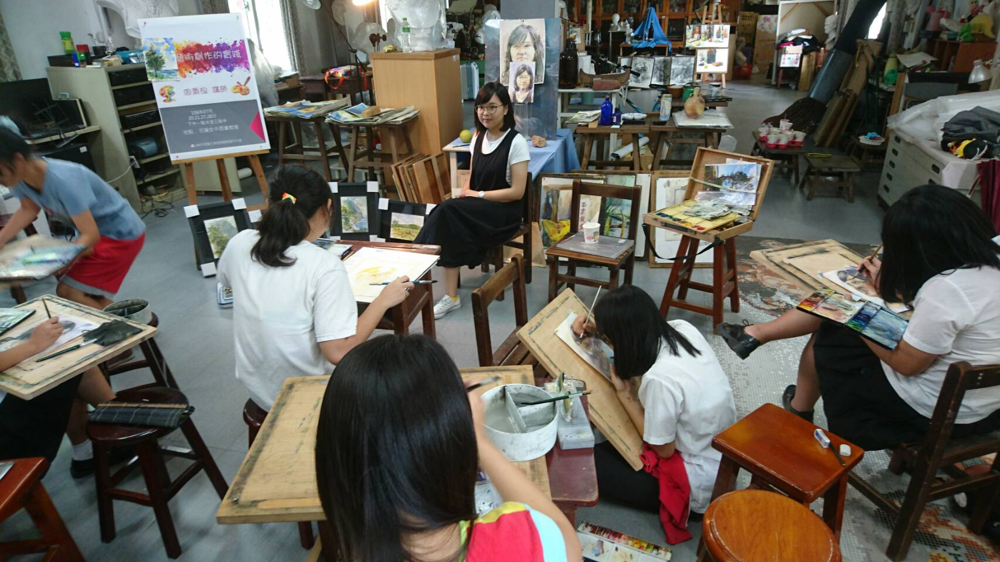 |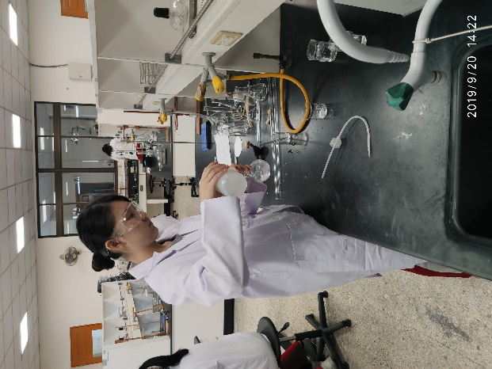 |
---

### 五、各班群課程差異與「轉組（轉換班群）」關鍵提醒

當同學於高二下學期或高二升高三考慮**轉換班群（自然組 A ⇄ 社會組 B）**時，務必對照以下五大核心差異，並向教務處註冊組與課諮老師確認學分銜接：

1. **部定必修《家政》(2 學分) 修習年級不同（極重要！）**：
   - **社會組（班群 B）於「高二上」修習《家政》(2)**；**自然組（班群 A）於「高三」才修習《家政》(2)**（與藝術生活對開）。
   -  **若「高二自然組  高三轉入社會組」**：妳在高二尚未修過《家政》，而高三社會組課表沒有開設《家政》！因此轉組前務必評估是否需利用重補修或跑班機制補修《家政》(2)，以免影響部定必修「綜合活動領域」及格學分。
2. **高二部定必修與加深加廣「跨類對開」差異**：
   - 自然組高二為 **《公民與社會》(2) 與《選修生物-動物體的構造與功能》(2) 上下學期對開**。
   - 社會組高二為 **《地理》(2) 與《探究與實作：地理與人文社會科學研究》(2) 上下學期對開**，且 **《物理-探究A》(2) 與《地球科學》(2) 上下學期對開**。
   -  **若於「高二上學期結束（寒假）申請轉組」**：可能因上下學期對開順序不同，導致《公民》、《地理》或《地球科學／物理探究A》少修或重複修習，須由教務處協助安排跑班或重補修。
3. **數學考科銜接（數 A vs 數 B ／ 數甲 vs 數乙）**：
   - 高二修數 B 的同學若高三想跨考採計數 A 或數甲之理工科系，需自行補足數 A 獨有單元（如空間向量、三階行列式、條件機率與貝氏定理、正餘弦函數疊合等）。
4. **分科測驗（Y）加深加廣考科範圍**：
   - 自然組高二已先修畢選修物理《力學一》(2)、選修化學《物質與能量》(2)+《物質構造與反應速率》(2)、選修生物《動物體》(2)；社會組高二則先修畢歷、地、公三門探究選修(各2)。轉組生須留意高二加深加廣基礎進度。

---

### 六、畢業條件與修課學分檢核表（普通班 ‧ 語資班 ‧ 數資班 ‧ 美術班）

依據教育部《高級中等學校學生學習評量辦法》與本校補充規定，學生三年應修習總學分為 **182 學分**，**畢業最低及格總學分為 150 學分**，且各班別須同時符合下列「部定必修、校訂必修、選修」之最低及格學分門檻（德行評量亦須符合規定）：

|班別 |應修總學分 |**畢業及格總學分門檻**|**① 部定必修及格門檻**|**② 校訂必修及格門檻**|**③ 選修課程及格門檻**| 檢核公式與特別提醒 |
|:--- |:---: |:---: |:--- |:--- |:--- |:--- |
|**普通班** *(自然組 A / 社會組 B)* |182 學分 |**≥ 150 學分**|**部定必修 ＋ 校訂必修 合計至少 102 學分及格** *(應修 118+4=122 學分，約 83.6%)* |*(併入左欄部定+校訂合計 ≥ 102 學分)* |**選修至少 40 學分及格** *(應修 60 學分，2/3 以上)* |注意：102 + 40 = 142 學分，仍須再多修及格 8 學分（必修或選修皆可）以湊滿 **150 學分**！ |
|**語文資優班**|182 學分 |**≥ 150 學分**|**一般科目至少 80% 及格** 應修 112  **至少 90 學分及格**|**特殊需求領域至少 85% 及格** 應修 30  **至少 26 學分及格** *(註：舊表印32/28，依實開30學分計為26)* |**選修至少 70% 及格** 應修 40  **至少 28 學分及格**|90 + 26 + 28 = 144 學分，總及格學分仍須達 **150 學分**！ |
|**數理資優班**|182 學分 |**≥ 150 學分**|**一般科目至少 80% 及格** 應修 108  **至少 87 學分及格**|**特殊需求領域至少 85% 及格** 應修 24  **至少 21 學分及格**|**選修至少 70% 及格** 應修 50  **至少 35 學分及格**|87 + 21 + 35 = 143 學分，總及格學分仍須達 **150 學分**！ |
|**美術資優班**|182 學分 |**≥ 150 學分**|**部定必修（含一般 86 + 藝才專長 60）＋ 校訂特需（8）合計至少 128 學分及格***(應修 154 學分)* |*(併入左欄部定+校訂合計 ≥ 128 學分)* |**選修至少 14 學分及格** *(應修 28 學分，50% 以上)* |128 + 14 = 142 學分，總及格學分仍須達 **150 學分**！ |
>  **想一鍵試算自己的及格學分是否達標？**> 請開啟本倉庫隨附的 **[`index.html` 互動式網頁版手冊](index.html)**，內建「**畢業學分互動檢核計算機**」，輸入目前學分即可即時顯示進度條與差額提醒！

  

  

>  **在花女三年中，有哪些是「可以自己決定」的課程與時間？**> 1. **選組與高二數學分流（高一下 5 月決定）**：選擇高二進入**班群 A（自然組）**或**班群 B（社會組）**，社會組同學還可選擇修習**數學 B**或**數學 A**。
> 2. **多元選修課程（高一上下、高二下、高三上下）**：每學期從 24～30 門豐富課程中選填志願跨班修習。
> 3. **加深加廣與補強性跑班選修（高二下、高三上下）**：依個人升學目標選修加深加廣或補強課程。
> 4. **彈性學習時間（每週五第 3、4 節）**：規劃**自主學習主題**（畢業前至少滿 18 節）、參加微課程或選手培訓。
> 5. **團體活動－社團時間（每週三第 6、7 節）**：從 34 個多元社團中選擇熱愛的領域投入！

  
   ▲ 花女一週課表：可以自己決定的課程與時間（高一選修、高三選修、團體活動時間、彈性學習時間）

### 一、自然組／社會組之不同課程 ＆ 高二數學 A vs 數學 B 深度解析

#### 1. 數學 A 與 數學 B 課程內容差異對照表（摘錄自行動學習網與課綱）

高一數學為全校共同必修（不分版），升上高二後分為 **「數學 A（高數學需求）」**與 **「數學 B（低數學需求／跨領域應用）」**兩種版本：

|學期／主題 | **高二數學 A（適合自然理工、生醫、資訊、高商管需求）**| **高二數學 B（適合文法政、傳播、藝術設計、一般商管需求）**|
|:--- |:--- |:--- |
|**高二上（第三冊）** **三角函數**|**三角函數完整理論**：弧度量、三角函數的圖形與性質、正餘弦的和角公式與倍角公式、**正餘弦函數的疊合**| **週期性數學模型**：弧度量、扇形弧長與面積、$\sin$ 的函數圖形與性質【數A簡單版】、週期性現象模型【數A不強調】 |
|**高二上（第三冊）** **指數與對數函數**|指數函數及其圖形、對數與對數律、對數函數及其圖形、指對數應用 | **按比例成長模型**：指數函數與圖形、常用對數與對數律、**自然對數 $e$ 與 $\ln x$、連續複利模型【數B獨有亮點】**|
|**高二上（第三冊）** **平面向量**|平面向量的運算、內積、**柯西不等式、正射影、兩直線夾角、二階行列式與面積公式**| **平面上的比例**：平面向量的加減與係數積、內積基本概念、**黃金比例、單點透視法與藝術設計應用【數B獨有！】**|
|**高二下（第四冊）** **空間概念與空間向量**|**空間概念、空間坐標系、空間向量的內積與外積、三階行列式、空間中的平面與直線方程式（含三元一次聯立方程組）**| **空間中的構圖與球面**：空間概念與三視圖、空間坐標系、**地球經緯度與球面截痕／圓錐曲線光學性質【數B獨有！】**|
|**高二下（第四冊）** **機率與矩陣**|**條件機率與貝氏定理**、矩陣的運算（加法、乘法、反矩陣）、**矩陣與平面線性變換（伸縮、旋轉、鏡射、推移）**|條件機率與獨立事件基本應用、矩陣的加減法與乘法、轉移矩陣基本應用（不含複雜線性變換與三階行列式） |
|圖 3-1：數學 A 與 數學 B 課程內容交集示意圖 |圖 3-2：大學各學群採計數學 A / 數學 B 統計示意圖 |
|:---: |:---: |
|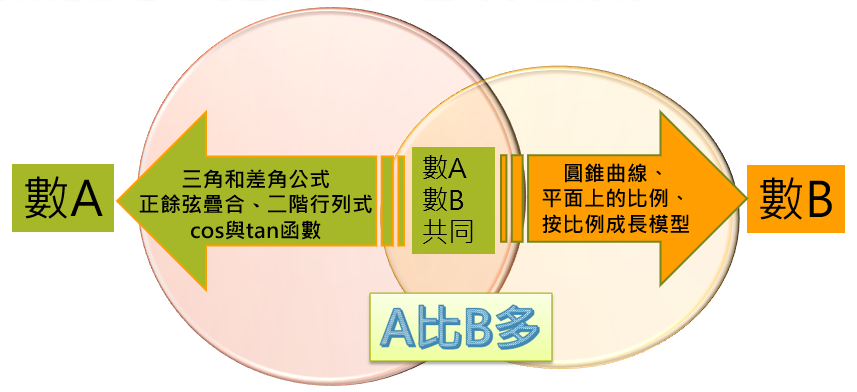 |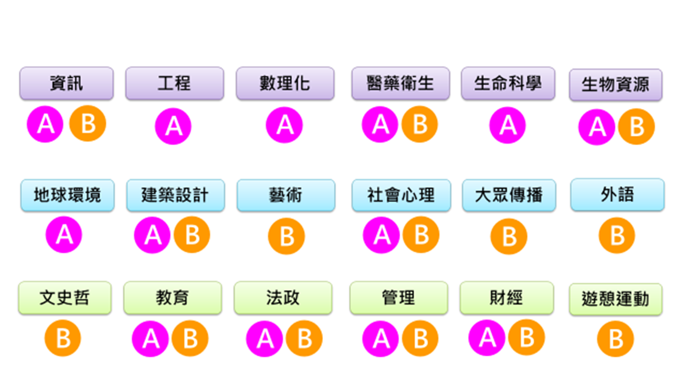 |
#### 2. 大學申請入學參採數學考科統計與學群建議

|參採數學類別 |系組數量（參考統計） |主要對應之大學學群與科系類型 |
|:--- |:---: |:--- |
|**僅參採「數學 A」**|**591 系**|資訊學群、工程學群、數理化學群、醫藥衛生學群、生命科學學群、生物資源學群、地球與環境學群，以及部分頂尖大學財金／經濟／資管系 |
|**僅參採「數學 B」**|**346 系**|財經學群、管理學群、社會與心理學群、法政學群、教育學群、建築與設計學群（部分）、文史哲／外語學群（部分） |
|**分組招生 或 數A/數B 擇一均可**|**104 系**|商管學院、傳播學院、設計學院或跨領域學士班（分 A/B 組或兩科皆可報名） |
|**不參採數學（國、英、社為主）**|**888 系**|外語學群、文史哲學群、藝術學群、大眾傳播學群、法政學群、遊憩與運動學群等 |
>  **最新簡章查詢入口**：[大學招生委員會聯合會 — 繁星推薦、申請入學、分發入學參採數學考科查詢系統](http://www.jbcrc.edu.tw/)（仍須以當學年度各校公布最新簡章為準）。

---

### 二、多元選修課程介紹（115 學年度高一 30 門 ＆ 高三 25 門完整清單）

本校於高一上、高一下、高二下（自然組或跑班）、高三上、高三下開設豐富多元的跨班選修課程（每門 2 學分），涵蓋**第二外語（日/韓/法/德/西/越/俄 7 國語言）**、**AI 科技與設計思考**、**在地海洋與人文踏查**、**自然科學與生活實作**、**法政財經與哲學思辨**等領域：

#### 1. 【115 入學高一適用】高一多元選修課程完整清單（共 30 門，一上、一下各選修 2 學分，不得重複）

>  **115 學年度高一新增 6 門亮點課程**：**《愛(AI)客共鄉》**、**《生活實用繩結與實作》**、**《刑法世界的秩序與權益》**、**《地景描繪 x 模型 x 地形》**、**《初級瑜珈》**、**《科技輔助設計思考於花女熊設計》**（原《ZINE 小誌創作》於 115 高一停開）。

|編號 |課程名稱 |學分 |領域／特色分類 |編號 |課程名稱 |學分 |領域／特色分類 |
|:---: |:--- |:---: |:--- |:---: |:--- |:---: |:--- |
|**01**|**基礎日語**|2 | 第二外語（日文五十音與會話） |**16**|**花蓮人文史地踏查**|2 | 在地文史與美崙溪/花蓮港實察 |
|**02**|**基礎韓語**|2 | 第二外語（韓文發音與文化） |**17**|**地圖繪製與地理資訊 (GIS)**|2 | 空間資訊與實地地圖踏查 |
|**03**|**基礎法語**|2 | 第二外語（法語入門與文化） |**18**|**地景描繪 x 模型 x 地形**|2 | 115新課：地理地景與立體模型實作 |
|**04**|**基礎德語**|2 | 第二外語（德語入門與文化） |**19**|**刑法世界的秩序與權益**|2 | 115新課：公民法學與刑法實例思辨 |
|**05**|**基礎西班牙語**|2 | 第二外語（西語入門與文化） |**20**|**思辨與表達（哲學思考）**|2 | 邏輯論證、公共議題與口語思辨 |
|**06**|**基礎越南語**|2 | 第二外語（東南亞語言與文化） |**21**|**理財初體驗**|2 | 金融素養、投資理財與經濟決策 |
|**07**|**基礎俄語**|2 | 第二外語（斯拉夫語言與文化） |**22**|**心理學與生活**|2 | 自我探索、人際心理與行為科學 |
|**08**|**愛(AI)客共鄉**|2 | 115新課：生成式 AI × 客家文化共創 |**23**|**生活中的物理實作**|2 | 動手做物理實驗與科學原理探究 |
|**09**|**科技輔助設計思考於花女熊設計**|2 | 115新課：設計思考 × 數位製造文創 |**24**|**微觀世界探索（生物顯微）**|2 | 顯微觀察、生物切片與生命奧秘 |
|**10**|**生活實用繩結與實作**|2 | 115新課：戶外繩結技術與生活工藝 |**25**|**趣味化學與生活應用**|2 | 手工皂、化妝品化學與實驗探究 |
|**11**|**初級瑜珈**|2 | 115新課：身心伸展、核心肌群與正念 |**26**|**程式設計與機器人實作**|2 | 演算法邏輯、感測器與機器人控制 |
|**12**|**英語繪本閱讀與創作**|2 | 外語閱讀、故事腳本與視覺創作 |**27**|**桌遊設計與策略分析**|2 | 賽局理論、機制設計與原型測試 |
|**13**|**新聞英語與國際視野**|2 | 國際時事閱讀、媒體識讀與口說 |**28**|**視覺藝術與手創設計**|2 | 複合媒材、美感構成與文創實作 |
|**14**|**文學電影與人生**|2 | 經典文學改編電影賞析與文本評論 |**29**|**烏克麗麗／吉他彈唱入門**|2 | 樂理基礎、和弦伴奏與音樂展演 |
|**15**|**海洋文學與黑潮文化**|2 | 太平洋黑潮書寫、海洋生態與閱讀 |**30**|**運動科學與體能訓練**|2 | 運動生理學、肌力訓練與健康管理 |
#### 2. 【113 入學高三適用】高三多元選修課程清單（每週四下午跑班，上、下學期各 2 學分）

高三多元選修共規劃 38 門候選課程（當學期實際開班約 24～25 門），包含：
- **第二外語進階與基礎班**：日語、韓語、法語、德語、西班牙語、越南語、俄語（含進階日語／進階韓語／進階法語）。
- **跨領域實作與科學應用**：《愛(AI)客共鄉》、《科技輔助設計思考於花女熊設計》、《從肌膚認識到保養品實作》、《料理科學：從產地到餐桌的美味關係》、《手沖咖啡與感官品評》、《植物染與自然手作》、《3D 列印與數位造物》。
- **人文藝術與社會法政**：《電影配樂賞析與創作》、《趣味民法與生活權益》、《刑法世界的秩序與權益》、《SDG 永續發展目標行動家》、《世界文化遺產巡禮》、《性別、媒體與現代社會》、《心理學專題探索》、《表達力與面試口語實戰》。

|圖 3-3：多元文化講座－印度傳統舞蹈文化演講 |圖 3-4：花蓮漁港魚市場踏查活動 |圖 3-5：地理科歐漢文老師指導學生 GIS 課程實地探查 |
|:---: |:---: |:---: |
|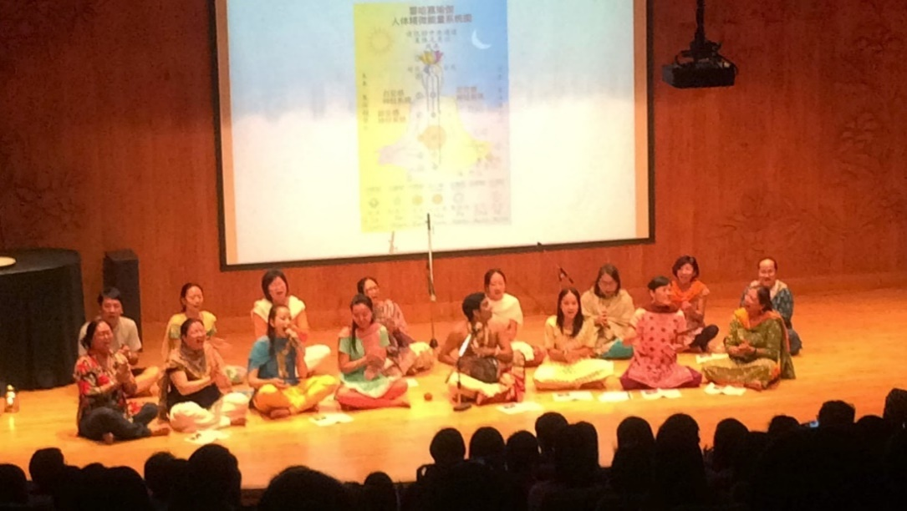 |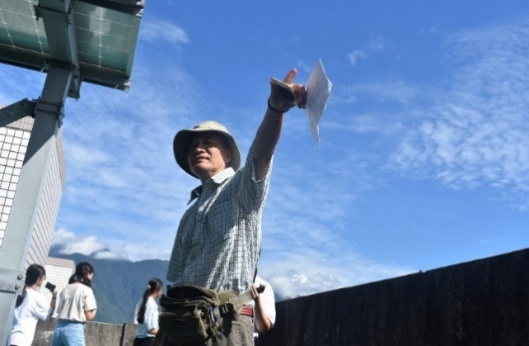 |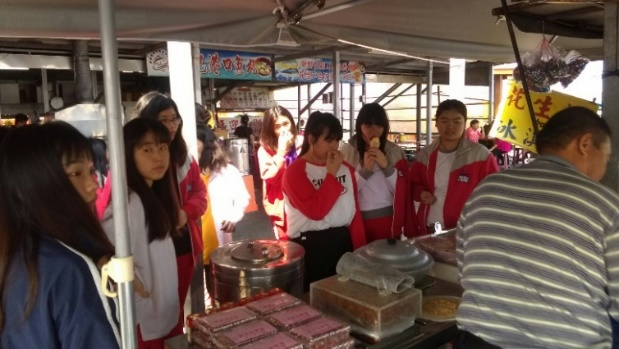 |
---

### 三、彈性學習時間（每週五第 3、4 節 ‧ 自主學習畢業前須滿 18 節！）

  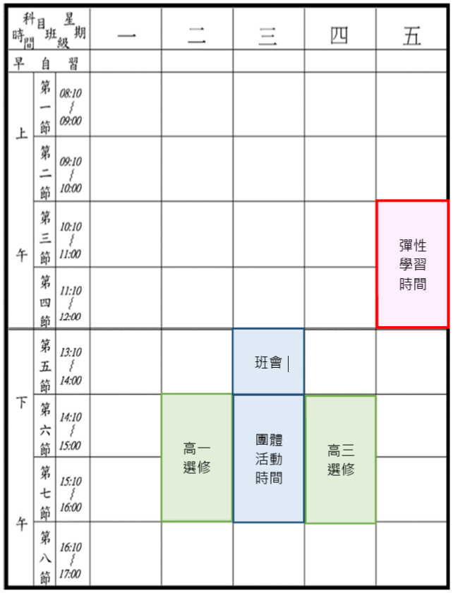

本校彈性學習時間安排於**每星期五第 3、4 節**（**115 入學高一為六個學期每週皆 2 節，三年共 12 節**；113、114 入學為高一下每週 1 節、其餘學期每週 2 節，三年共 11 節）。包含四大實施類別：

1. **學生自主學習（畢業前至少須修習滿 18 節以上！）**：
   - 學生依個人興趣與升學方向擬定《自主學習計畫書》，經指導教師與家長審核後，於指定場地（圖書館、電腦教室、實驗室、自習教室）執行計畫並撰寫紀錄，期末完成成果報告，可上傳至「學習歷程檔案—多元表現」或整理為申請入學備審亮點。
2. **選手培訓**：具有學校代表隊、語文競賽、學科能力競賽、科展、音樂／美術比賽代表身分之選手，由指導老師進行專項培訓。
3. **學校特色活動**：由學校舉辦全年級或分年級之講座、跨領域體驗、大學參訪、國際交流與生涯輔導活動。
4. **充實（增廣）／補強性教學（微課程）**：
   學校每學期邀請校內外專家開設為期 **4～6 週的「微課程」**，協助同學探索興趣、增進學習技巧或特殊技能。歷年熱門微課程範例包括：
   - 《基礎越語》、《簡易木工實作》、《資訊繪圖版應用》、《芳香療法與精油調配》、《肢體開發與戲劇表達》、《Python 資料分析入門》、《Canva 視覺排版與簡報設計》、《基礎攝影與構圖》、《運動貼紮與傷害防護》。

|微課程實況 A：校外職人實作工作坊 |微課程實況 B：跨領域動手做體驗 |微課程實況 C：小組發表與實作交流 |
|:---: |:---: |:---: |
|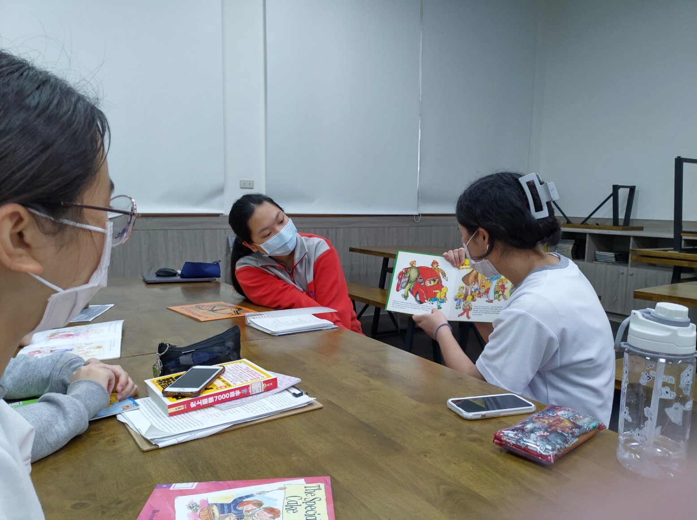 |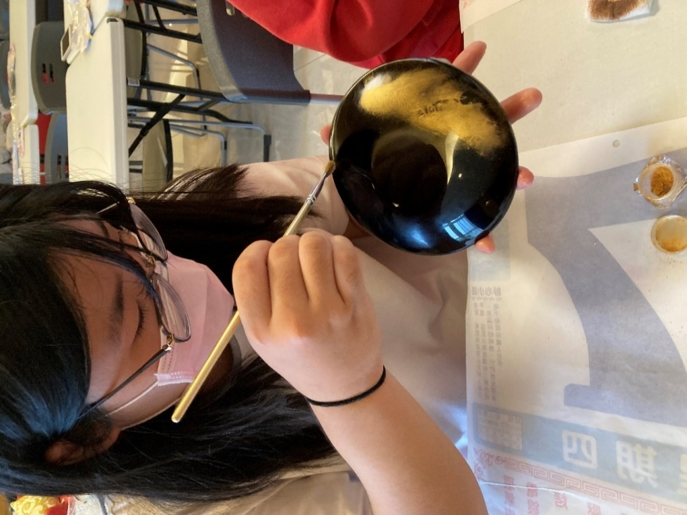 |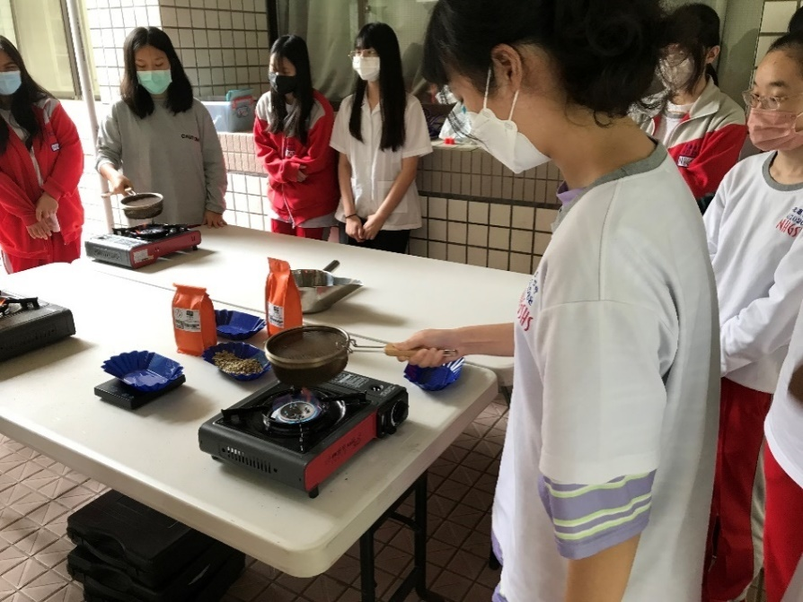 |
---

### 四、團體活動時間與花女 34 個多元社團全覽（每週三第 5～7 節）

團體活動時間安排於**每星期三下午**：
- **第 5 節**：班級活動（班會）、週會、名人講座、性平／人權／環境／交通安全宣導、班際競賽。
- **第 6、7 節**：社團活動（每學期約 8～10 次社團課，高一、高二同學皆須參加社團）。

#### 表 3-1：國立花蓮女中 34 個學生社團完整一覽表

|社團類別 |社團編號與名稱 |
|:--- |:--- |
|**任務性社團（6 個）**|**01 班聯會**‧ **02 畢聯會***(高三)* ‧ **03 環保糾察社**‧ **04 交通服務社**‧ **05 司儀社**‧ **06 典禮禮兵社**|
|**一般性社團－音樂與表演類（7 個）**|**07 合唱團**‧ **08 管樂社**‧ **09 國樂社**‧ **10 熱音社**‧ **11 吉他社**‧ **12 流舞社（流行舞蹈）**‧ **13 儀隊社**|
|**一般性社團－學術、語文與藝文類（10 個）**|**14 校刊社（花女青年）**‧ **15 演辯社**‧ **16 英語會話社**‧ **17 日文研究社**‧ **18 韓流研究社**‧ **19 漫研社（動漫研究）**‧ **20 桌遊社**‧ **21 電影欣賞社**‧ **22 攝影社**‧ **23 美食研究社（烹飪）**|
|**一般性社團－體育與康樂類（5 個）**|**24 籃球社**‧ **25 排球社**‧ **26 羽球社**‧ **27 桌球社**‧ **28 康輔社**|
|**服務性社團（6 個）**|**29 春暉社**‧ **30 紅十字會青少年服務社（紅青社）**‧ **31 紫錐花社**‧ **32 圖書資訊服務社**‧ **33 輔導義工社（心輔社）**‧ **34 醫療服務社（醫服社）**|

  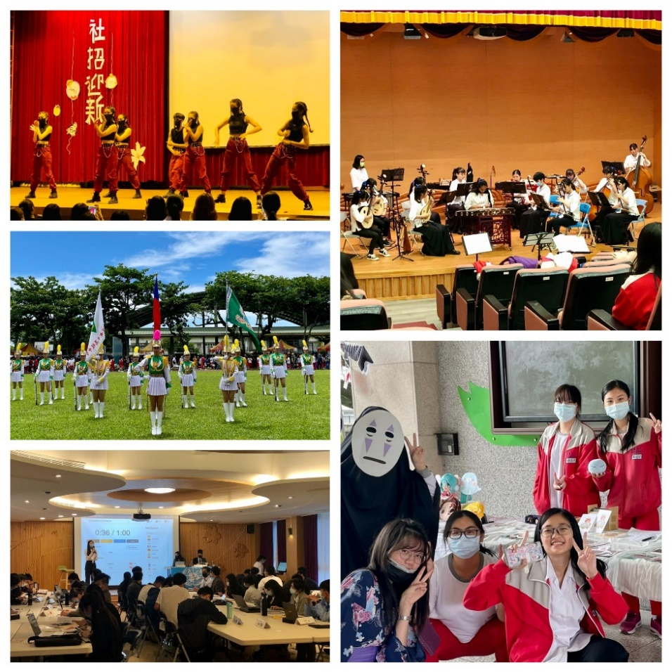

 <b>點擊展開檢視：團體活動時間上、下學期行事曆範例表</b>

 

|項目 |上學期（第 1 學期）重點活動 |下學期（第 2 學期）重點活動 |
|:--- |:--- |:--- |
|**全校／分年級週會講座**|開學典禮、幹部訓練、友善校園週、法治與人權教育講座、性平教育講座、防災演練、名人職涯分享 |生涯規劃講座、高一選組輔導說明會、高二學習歷程與升學講座、環境教育參訪、國際教育交流講座 |
|**班際與校園特色活動**|**班際排球賽**、**高一合唱比賽**、英語歌唱比賽、教室佈置競賽、校慶運動會預演 |**班際籃球賽**、**社團動態成果發表會**、社團靜態展、飢餓十二／公益體驗、畢業典禮籌備 |
|**社團活動（第 6-7 節）**|社團線上選填志願、社團迎新、期中社課（共約 8～10 次） |下學期社課、校外服務學習、社團成發排練與幹部交接（共約 8～10 次） |

  

  

### Swain 生涯金三角（圖 4-1）

>  **「真正的生涯規劃是幫自己找到一條適合自己的路，而不是找一條人們認為最好的路。」**> 學者 Swain 提出的**生涯金三角（圖 4-1）**指出，在做任何選組、選課與大學科系決策前，必須同時衡量三個維度：
> 1. **自我認識（認識自己）**：我的能力／性向、興趣（Holland 六型）、人格特質與價值觀是什麼？
> 2. **教育與職業資料（認識教育與世界）**：高中班群有哪些課？大學十八學群、學類與未來職場需要什麼能力？
> 3. **社會環境因素（認識環境助力與阻力）**：家人期待、經濟條件、社會產業趨勢與升學制度變化。

  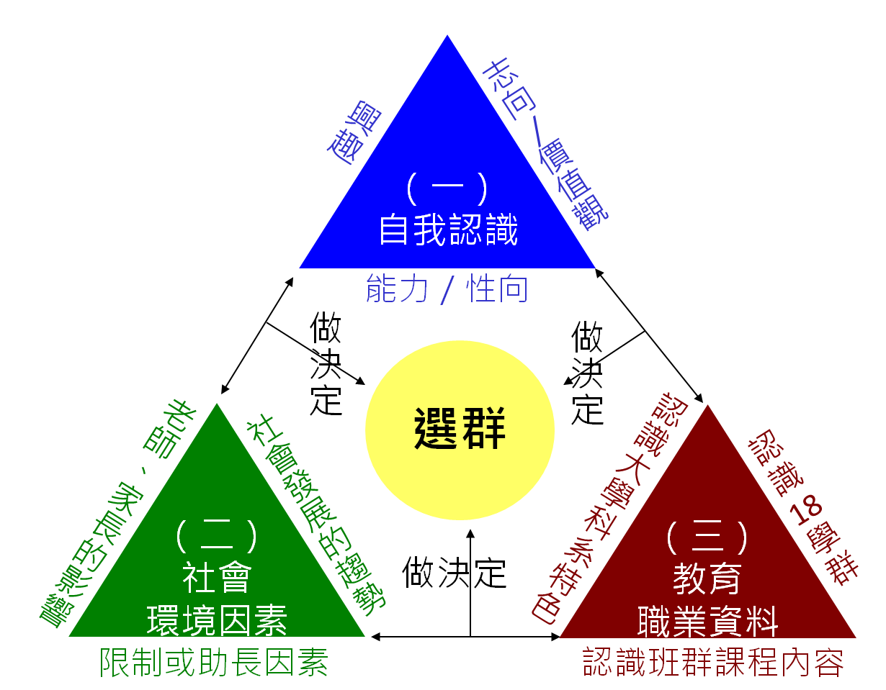

---

### 一、自我認識：新編多元性向測驗 ＆ 大考中心興趣量表

高一同學於生涯規劃課與輔導活動中，會施測**「新編多元性向測驗」**（了解自己的潛能與優勢能力）與**「大考中心興趣量表」**（了解自己喜歡做的事）：

#### 表 4-1：新編多元性向測驗（8 大分測驗與對應學科／職業）

|分測驗名稱 |測驗能力定義 |密切相關之高中學科與未來職業領域 |
|:--- |:--- |:--- |
|**1. 語文推理**|對語詞概念的理解、類推與邏輯推理能力 |國文、歷史、公民；**廣告、出版、法律、教育、新聞、傳播、行政管理**|
|**2. 數字推理**|運用數字進行計算、分析數量關係與推理之能力 |數學、物理、化學、經濟；**會計、財務金融、統計、精算、工程、資訊、自然科學研究**|
|**3. 圖形推理**|對於各種抽象圖形、符號線索變化規律之推斷能力 |數學幾何、自然探究、程式邏輯；**資訊工程、軟體設計、數理研究、系統分析**|
|**4. 機械推理**|對日常物理原理、力學結構與機械運作規則之理解能力 |物理、生活科技、工程設計；**機械工程、土木建築、航太、電機、工業設計、自動化工程**|
|**5. 空間關係**|關於方位空間關係之視覺領悟力、觀察力與立體圖樣想像力 |數學空間向量、地理、美術；**建築、室內設計、工業設計、地政測量、製圖、外科牙醫、飛行駕駛**|
|**6. 中文詞語**|對中文字詞意義之辨識、閱讀理解與語感掌握能力 |文組學科成就；**作家、編輯、記者、秘書、教師、圖書館員、法律工作者**|
|**7. 英文詞語**|對英文字彙量、語意辨識與外語學習潛能之掌握能力 |英語文、第二外語；**外交官、翻譯、國際貿易、外商管理、空服、跨國科技與學術研究**|
|**8. 知覺速度與確度**|對細微文字符號進行快速比對、檢核與維持高正確率之能力 |資料整理與實驗紀錄；**會計審計、銀行金融、藥師、醫事檢驗、品質管制、行政文書**|
>  **如何認識自己的性向組合？**> - **理工傾向組合**：數字推理 ＋ 圖形推理 ＋ 機械推理／空間關係。
> - **文科傾向組合**：語文推理 ＋ 中文詞語 ＋ 英文詞語。
> - **商管傾向組合**：語文推理 ＋ 數字推理 ＋ 知覺速度與確度。

  

---

#### 表 4-2：大考中心興趣量表說明（Holland 生涯興趣六大類型 RIASEC）

|代碼與類型 |人格特質與偏好活動 |喜歡的生活與工作方式 |代表學群與職業方向 |
|:---: |:--- |:--- |:--- |
|**R 實用型** *(Realistic)* |情緒穩定、有耐性、坦誠直率；喜歡動手操作工具、機械、電子設備、動植物飼育或戶外活動 |講求實際、按部就班完成具體成品，較少依賴複雜人際應酬 |**工程學群、資訊學群、生物資源學群**（工程師、建築技術、農林漁牧、運動員） |
|**I 研究型** *(Investigative)* |善於觀察、思考、分析與推理；喜歡探索自然、數理、生醫或社會現象背後的原理，追求真理 |喜歡獨立研究、動腦解決抽象或高難度問題，不喜歡受制式規範束縛 |**數理化學群、醫藥衛生學群、生命科學學群、地球與環境學群、資訊學群**（科學家、醫師、研究員、數據分析師） |
|**A 藝術型** *(Artistic)* |直覺敏銳、富想像力與創造力；喜歡藉文字、聲音、色彩、動作或形式表達美感與創意 |喜歡無拘無束、展現獨特風格與感性體驗的生活 |**藝術學群、建築與設計學群、大眾傳播學群、文史哲學群、外語學群**（設計師、藝術家、導演、作家、音樂人） |
|**S 社會型** *(Social)* |溫暖友善、樂於助人、善解人意；喜歡教導、諮商、醫護照護、傾聽與促進他人成長 |重視人際和諧、社會公益與團隊互動，樂於為他人付出 |**教育學群、社會與心理學群、醫藥衛生學群（護理/治療）、遊憩與運動學群**（教師、心理師、社工師、護理師） |
|**E 企業型** *(Enterprising)* |精力充沛、自信果斷、具說服力與領導力；喜歡策劃、組織、行銷、管理、談判與競逐目標 |追求成就感、影響力與經濟報償，樂於帶領團隊開創新局 |**管理學群、財經學群、法政學群、大眾傳播學群**（企業經理人、律師、政治人物、行銷企劃、創業家） |
|**C 事務型** *(Conventional)* |謹慎細心、有條理、負責守規；喜歡處理數據、財務報表、檔案建置與標準化作業流程 |喜歡穩定、規則明確、精確無誤的環境，能高效維持組織運作 |**財經學群（會計/財稅/銀行）、管理學群（資管/行政）、法政學群（地政/公職）**（會計師、精算師、金融人員、公務員） |

  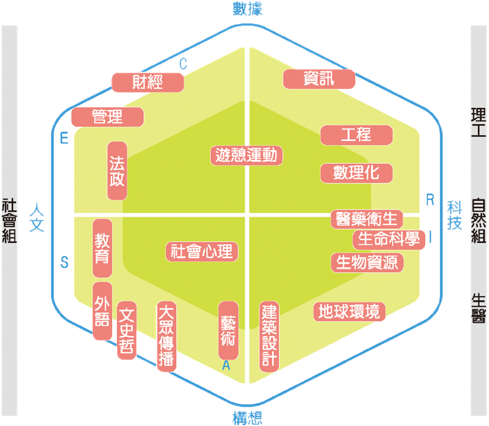

---

### 二、社會環境因素

在進行選組與志願探索時，除了認識自我，也要主動了解**家庭期待、經濟支持、產業趨勢（如 AI 半導體、綠能永續、高齡醫療照護、數位文創、跨國電商）**。當個人興趣與父母期待不一致時，建議帶著本手冊的「十八學群介紹」與「性向／興趣測驗結果」，並善用學校**課程諮詢教師**與**輔導室**資源，以具體數據與未來職涯出路和家人溫和溝通。

---

### 三、認識學群、學類與科系（大學十八學群完整總表 ＆ 高中班群對應）

#### 表 4-3 ＆ 表 4-4：大學十八學群基本概念、主要學類與「花女高中班群（自然組 A／社會組 B）」對應總表

|學群編號與名稱 |學群核心概念簡介 |包含之主要學類（科系） |**對應高中班群**|**建議選修數學版本**|
|:--- |:--- |:--- |:---: |:---: |
|**01 資訊學群**|研究軟硬體架構、演算法、人工智慧、資安、網路通訊與資訊系統管理應用 |資訊工程、資訊科學、資訊管理、數位媒體設計、資訊傳播、圖書資訊、生物資訊、數位學習 |**自然組（班群 A）為主** *(資管/資傳/圖資部分可由社會組報考)* |**數 A 為主** *(高三數甲)* |
|**02 工程學群**|運用數學與自然科學原理，解決能源、材料、製造、通訊、營建與交通等實務工程問題 |電機工程、電子工程、光電、機械、材料、化工、土木、水利、環工、航太、工業工程、生醫工程 |**自然組（班群 A）**|**數 A** *(高三數甲)* |
|**03 數理化學群**|探究數學邏輯、物理定律、化學分子結構與統計數據分析之基礎科學與跨領域應用 |數學、應用數學、統計、物理、應用物理、化學、應用化學、自然科學教育 |**自然組（班群 A）**|**數 A** *(高三數甲)* |
|**04 醫藥衛生學群**|維護人類身心健康、疾病診斷治療、藥物研發、公共衛生與長期照護之專業領域 |醫學、牙醫、中醫、藥學、護理、醫學檢驗、物理治療、職能治療、呼吸治療、營養、公共衛生、醫務管理 |**自然組（班群 A）為主** *(公衛/醫管/部分護理由社會組亦可報考)* |**數 A 為主** *(高三數甲)* |
|**05 生命科學學群**|從分子、細胞、遺傳基因到生態系統，探索生命現象奧秘與生物科技研發 |生命科學、生物科技、分子生物、微生物、生化科技、神經科學、生物資訊 |**自然組（班群 A）**|**數 A** *(高三數甲)* |
|**06 生物資源學群**|研究農作物、森林、水產養殖、畜牧獸醫與食品加工，兼顧糧食生產與生態保育 |農藝、園藝、森林、動物科學、獸醫、植物醫學、水產養殖、食品科學、農業經濟 |**自然組（班群 A）**|**數 A** *(高三數甲)* |
|**07 地球與環境學群**|探討地球地質、大氣氣象、海洋科學、太空天文與地理空間環境變遷 |地球科學、地質、大氣科學、海洋科學、海洋環境、環境科學、地理（自然組） |**自然組（班群 A）**|**數 A** *(高三數甲)* |
|**08 建築與設計學群**|結合工程結構、空間美學、使用者體驗與數位媒材，進行建築、都市與產品視覺設計 |建築、室內設計、景觀設計、都市計畫、工業設計、商業設計、視覺傳達設計、服裝設計、多媒體設計 |**自然組 A ／ 社會組 B ／ 美術班 皆可**|**數 A 或 數 B** *(建築多採數A；設計多採數B或不採)* |
|**09 藝術學群**|透過美術、音樂、戲劇、舞蹈與新媒體進行美感創作、展演與藝術評論行政 |美術、雕塑、書畫、音樂、戲劇、劇場設計、舞蹈、藝術史、藝術教育、文化資產與藝術行政 |**美術班 ／ 社會組 B***(自然組亦可跨考)* |**不參採 或 數 B**|
|**10 社會與心理學群**|探究人類心理歷程、諮商輔導、社會結構、社工福利與人類學族群文化 |心理、輔導與諮商、社會、社會工作、人類學、民族學、兒童與家庭、犯罪防治、勞工關係 |**社會組 B ／ 自然組 A 皆可** *(部分大學心理系分自然/社會組招生)* |**數 B 或 數 A**|
|**11 大眾傳播學群**|研究新聞採訪、廣播電視電影、廣告公關、數位新媒體敘事與傳播理論 |新聞、廣播電視、電影、廣告、公共關係、大眾傳播、資訊傳播、圖文傳播、口語傳播 |**社會組（班群 B）***(自然組亦可跨考)* |**數 B 或 不參採**|
|**12 外語學群**|深入學習英美、歐亞各國語言、文學、文化、語言學、翻譯與跨文化國際溝通 |英國語文、應用外語、日本語文、法國語文、德國語文、西班牙語文、韓國語文、俄國語文、東南亞語文、翻譯 |**社會組 B ／ 語資班***(自然組亦可跨考)* |**不參採 或 數 B**|
|**13 文史哲學群**|探究中外文學經典、歷史脈絡、哲學思想、台灣文化、宗教與圖書文獻保存 |中國文學、台灣文學、歷史、哲學、宗教、文化產業、圖書資訊、華語文教學 |**社會組 B ／ 語資班***(自然組亦可跨考)* |**不參採 或 數 B**|
|**14 教育學群**|培育各級學校師資、特殊教育、幼兒教育、教育心理、課程科技與成人學習人才 |教育、特殊教育、幼兒教育、教育心理與輔導、學習與媒材設計、體育教育、各學科師資培育學系 |**社會組 B ／ 自然組 A***(依任教學科而定)* |**數 B 或 數 A**|
|**15 法政學群**|研究法律規範、司法正義、政治制度、公共行政、外交國際關係與地政管理 |法律、財經法律、政治、公共行政、外交、國際關係、地政、土地管理 |**社會組（班群 B）***(自然組亦可跨考)* |**數 B 或 不參採** *(部分政經/地政採數A或數B)* |
|**16 管理學群**|學習企業組織、策略規劃、行銷、人資、作業供應鏈、醫療與觀光服務管理 |企業管理、國際企業、行銷與流通、工業管理、資訊管理、科技管理、醫務管理、觀光事業、餐旅管理 |**社會組 B ／ 自然組 A 皆可**|**數 B 或 數 A** *(頂大企管/工管/資管多採數A；高三數乙)* |
|**17 財經學群**|探究資金市場、銀行保險、投資精算、會計審計、國際貿易與總體／個體經濟學 |財務金融、會計、經濟、國際貿易、財政稅務、風險管理與保險、統計與精算 |**社會組 B ／ 自然組 A 皆可**|**數 A 或 數 B** *(頂大財金/經濟/精算多採數A；高三數乙)* |
|**18 遊憩與運動學群**|結合運動競技、運動保健科學、休閒遊憩規劃、觀光領隊與賽事場館經營 |體育、運動競技、運動保健、運動管理、休閒事業管理、觀光遊憩 |**社會組 B ／ 自然組 A 皆可**|**數 B 或 不參採***(運動科學部分採數A)* |
---

#### 表 4-5：生涯、升學資訊相關網站（15 大官方與實用平台）

|網站名稱 |網址連結 |功能與使用時機說明 |
|:--- |:--- |:--- |
|**1. ColleGo! 大學選才與高中育才輔助系統**|https://collego.edu.tw/ |大考中心建置！查詢 **18 學群、學類、各大學校系介紹、三年修課建議與能力特質**|
|**2. 漫步在大學（大學校系查詢系統）**|https://unews.com.tw/ |查詢全國各大學校系課程、師資、獎學金、雙主修與歷年篩選標準 |
|**3. 104 升學就業地圖**|https://www.104.com.tw/jb/career/department/ |查詢各大學科系畢業後的**真實就業流向、職務比例與薪資分布**|
|**4. IOH 開放個人經驗平台**|https://ioh.tw/ |觀看全國各大學學長姐與海內外工作者的**真人影片經驗分享**|
|**5. 大學入學考試中心（CEEC）**|https://www.ceec.edu.tw/ |英聽、學測（X）、分科測驗（Y）簡章、歷屆試題與興趣量表資源 |
|**6. 大學招生委員會聯合會**|http://www.jbcrc.edu.tw/ |查詢大學繁星推薦、申請入學、分發入學**參採數學考科與學習歷程參採項目**|
|**7. 大學甄選入學委員會**|https://www.cac.edu.tw/ |**繁星推薦**與**申請入學**官方網站（簡章查詢、歷年篩選級分、線上報名） |
|**8. 大學考試入學分發委員會**|https://www.uac.edu.tw/ |**分發入學**官方網站（分科測驗採計組合、歷年最低錄取分數、登記志願） |
|**9. 技專校院招生委員會聯合會**|https://www.jctv.ntut.edu.tw/ |**高中生申請四技（科技大學）**入學簡章與招生管道查詢 |
|**10. 大學多元入學升學網**|http://nsdua.moe.edu.tw/ |教育部匯整之各大學特殊選才、獨招、繁星、申請、分發最新公告 |
|**11. 作伙學：學習歷程檔案審議計畫**|https://www.108epo.com/ |臺大團隊主持，提供**課程學習成果與多元表現實例範本**及大學教授審查觀點 |
|**12. 國立花蓮女中生涯輔導資訊網**|https://www.hlgs.hlc.edu.tw/ |本校輔導室與教務處最新升學講座、營隊、模擬面試與獎學金公告 |
|**13. 職業就業指南（勞動部台灣就業通）**|https://www.taiwanjobs.gov.tw/ |職涯測驗、各行業職能基準與未來新興職業趨勢查詢 |
|**14. 教育部青年發展署（Rich 職場體驗網）**|https://rich.yda.gov.tw/ |政府公部門、企業暑期實習與青年職涯探索計畫 |
|**15. UCAN 大專校院就業職能平台**|https://ucan.moe.edu.tw/ |教育部職能診斷與 16 職涯類型探索參考 |

  

  

### 一、紀錄學習歷程（Student Learning Portfolio — P1）

#### 1. 為什麼要做學生學習歷程檔案（P1）？
十二年國教課綱實施後，每位高中生都擁有專屬於自己的**「學生學習歷程檔案（P1）」**，完整記錄妳從高一到高三在校三年的學習成績、課程學習成果與多元表現。不需要等到高三下準備申請大學時才急忙回憶整理，可直接從每學期累積並通過認證的學習歷程檔案中，勾選最適合的資料傳送至申請的大學校系，具體展現個人特色與適性發展軌跡！

  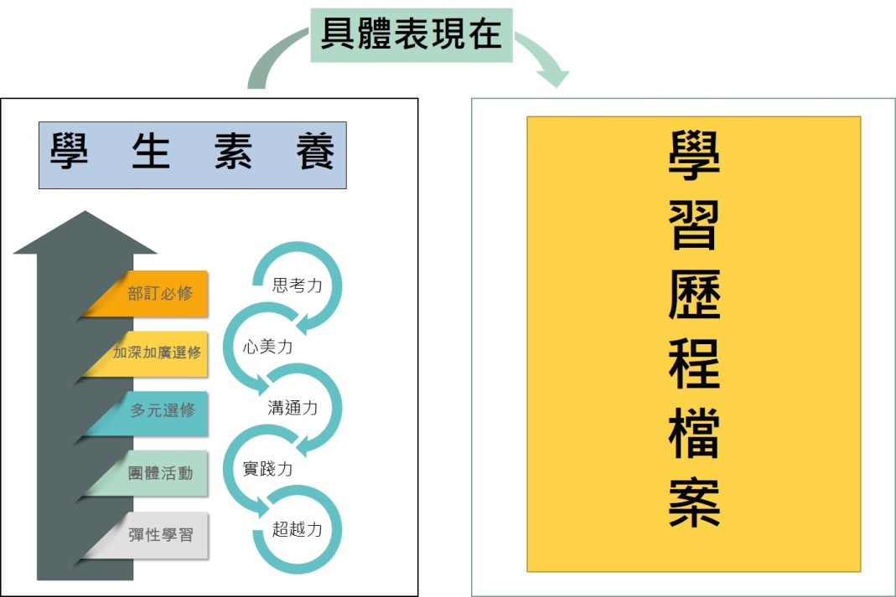

#### 2. 學習歷程檔案六大核心內容與上傳規範

|項目編號與名稱 |負責登錄／上傳者 |內容與每學期／每學年件數規範 |
|:--- |:---: |:--- |
|**① 基本資料**|學校註冊組／學務處 |學生姓名、學籍資料、每學期擔任之**校內幹部紀錄**（班級幹部、社團幹部、全校性自治幹部） |
|**② 修課紀錄**|學校註冊組 |高一至高三修習之部定必修、校訂必修、加深加廣選修、多元選修、補強選修之**科目名稱、學分數與學期成績**|
|**③ 課程學習成果**|**學生每學期上傳 → 任課教師認證 → 學生勾選提交**|凡「**有學分且老師會評分**」之必修與選修課程作品（書面報告、實作作品、自然／社會探究與實作報告、小論文等）。  **校內平台每學期可上傳至多 30 件請老師認證；每學期可勾選至多 3 件（每學年 6 件，三年共 18 件）提交至中央資料庫**，申請大學時至多勾選 **3 件**。 |
|**④ 多元表現**|**學生自行上傳 → 每學年勾選提交**|彈性學習時間（**自主學習成果**、微課程、選手培訓）、社團活動、競賽表現、檢定證照、服務學習、非修課紀錄之成果作品、特殊優良表現。  **每學年可勾選至多 10 件（三年共 30 件）提交至中央資料庫**，申請大學時至多勾選 **10 件**。 |
|**⑤ 學習歷程自述**|高三申請入學時撰寫上傳 |包含 **(1) 高中學習歷程反思**、**(2) 就讀動機**、**(3) 未來學習計畫與生涯規劃**（＋ **多元表現綜整心得**）。 |
|**⑥ 其他資料**|高三依校系規定上傳 |大學校系於申請入學簡章中額外指定之有利審查資料。 |
#### 3. 本校課程學習成果認證作業流程（7 大步驟）

  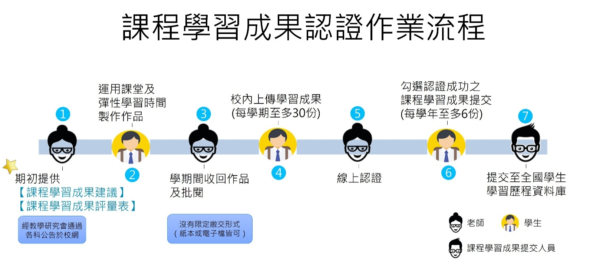

1. **步驟 1（教師準備）**：學期初任課教師提供「課程學習成果規劃書」與「課程學習成果評量表」（經教學研究會通過並公告於校網）。
2. **步驟 2（學生產出）**：學生利用課堂與課餘時間完成課程作業、專題或實作作品。
3. **步驟 3（教師評閱）**：任課教師於學期中收件並給予評分與修改回饋（紙本或電子檔皆可）。
4. **步驟 4（學生上傳）**：學生於校內期限內，將修正完善之成果上傳至校內學習歷程平台（每學期至多上傳 30 件；**文件檔上限 4MB 限 PDF/PNG/JPG，影音檔上限 10MB 限 MP3/MP4**）。
5. **步驟 5（教師認證）**：任課教師於系統進行線上認證。
6. **步驟 6（學生勾選）**：學生自「已通過教師認證」之課程學習成果中，**每學期勾選至多 3 件（每學年 6 件）**。
7. **步驟 7（提交中央資料庫）**：由學校提交人員統一提交至「全國學生學習歷程資料庫」（**一旦提交至中央資料庫即不得修改或替換**！）。

#### 4. 查詢各大學科系參採內容

  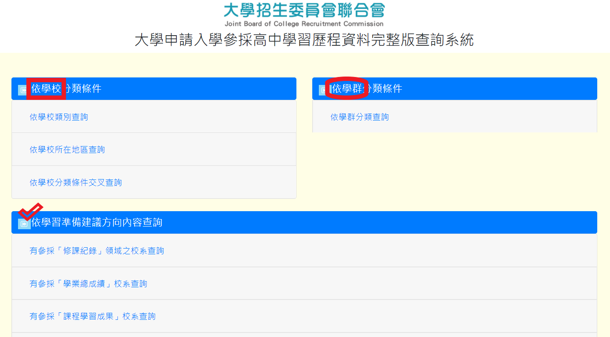

-  **[大學申請入學參採高中學習歷程資料完整版查詢系統（招聯會）](http://www.jbcrc.edu.tw/)**（短網址：`https://reurl.cc/0jkQZo`）
-  **[四技日間部申請入學聯合招生學習準備建議方向查詢](https://www.jctv.ntut.edu.tw/caac/)**（短網址：`https://reurl.cc/4aOXkR`）

---

### 二、了解升學管道（大考時程 ‧ 學測 X 與分科 Y 範圍 ‧ 多元入學與特殊管道）

#### 1. 高三各項升學考試與入學管道時間表（10 月 ～ 次年 8 月）

  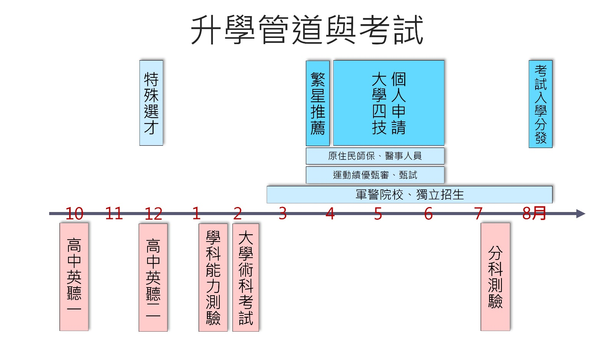

#### 2. 學測（X）、分科測驗（Y）與綜合學習表現（P）架構與測驗範圍

  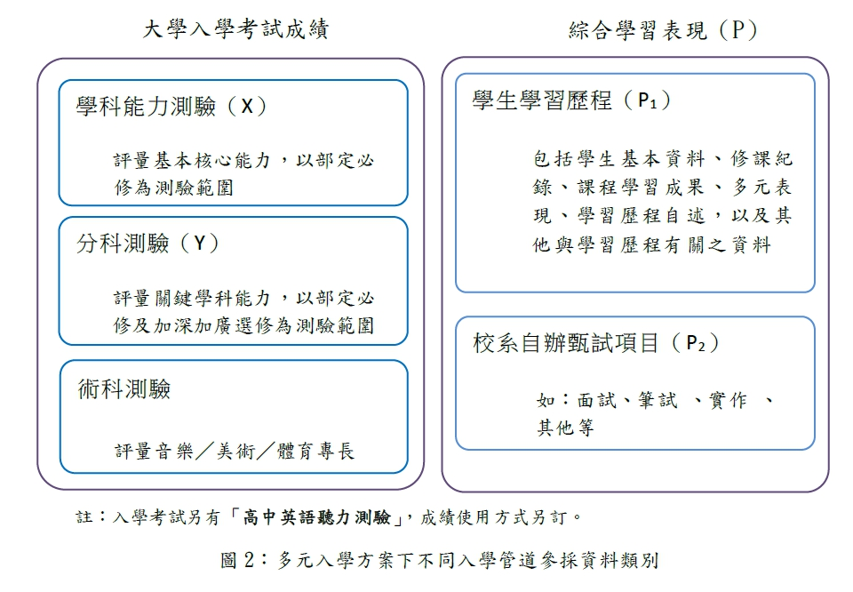

##### 表 5-1：學科能力測驗（X）測驗範圍 — 部定必修基本學力（高三上 1 月施測）

|學測考試科目 |測驗範圍（皆為部定必修課程） |
|:---: |:--- |
|**國文**（國綜＋國寫） |高一、高二、高三上**部定必修國語文**|
|**英文**|高一、高二、高三上**部定必修英語文**|
|**數學 A**|高一必修數學（8 學分）＋ **高二必修數學 A 類（8 學分）**|
|**數學 B**|高一必修數學（8 學分）＋ **高二必修數學 B 類（8 學分）**|
|**社會**|部定必修**歷史（6 學分）**、部定必修**地理（6 學分）**、部定必修**公民與社會（6 學分）**|
|**自然**|部定必修**物理**、**化學**、**生物**、**地球科學**（含**自然科學探究與實作 A、B 共 4 學分**） |
##### 表 5-2：分科測驗（Y）測驗範圍 — 關鍵學科深度能力（高三下 7 月施測）

|分科測驗科目 |部定必修範圍 |部定加深加廣選修範圍 |
|:---: |:--- |:--- |
|**數學甲**|高一必修數學 ＋ 高二必修數學 A 類 |**數學甲（8 學分）**|
|**數學乙**|高一必修數學 ＋ 高二必修數學 A 類與數學 B 類共同內容 |**數學乙（8 學分）**|
|**歷史**|部定必修歷史（6 學分） |**《族群、性別與國家的歷史》(3) ‧ 《科技、環境與藝術的歷史》(3) ‧ 《探究與實作：歷史學探究》(2)**|
|**地理**|部定必修地理（6 學分） |**《社會環境議題》(3) ‧ 《空間資訊科技》(3) ‧ 《探究與實作：地理與人文社會科學研究》(2)**|
|**公民與社會**|部定必修公民與社會（6 學分） |**《現代社會與經濟》(3) ‧ 《民主政治與法律》(3) ‧ 《探究與實作：公共議題與社會探究》(2)**|
|**物理**|部定必修物理 |**《力學一》(2) ‧ 《力學二與熱學》(2) ‧ 《波動、光及聲音》(2) ‧ 《電磁現象一》(2) ‧ 《電磁現象二與量子現象》(2)**|
|**化學**|部定必修化學 |**《物質與能量》(2) ‧ 《物質構造與反應速率》(2) ‧ 《化學反應與平衡一》(2) ‧ 《化學反應與平衡二》(2) ‧ 《有機化學與應用科技》(2)**|
|**生物**|部定必修生物 |**《細胞與遺傳》(2) ‧ 《生命的起源與植物體的構造與功能》(2) ‧ 《動物體的構造與功能》(2) ‧ 《生態、演化及生物多樣性》(2)**|
#### 3. 大學多元入學四大主要管道與四技申請比較

|入學管道名稱 |辦理時程 |核心招生條件與參採項目 |志願數上限與特色 |官方網站 |
|:--- |:---: |:--- |:--- |:--- |
|**特殊選才**|高三上 **10～12 月**|**不看學測成績**！由各大學獨立招生，招收具特殊專長、單一學科競賽優異、新住民／實驗教育或逆境向學之偏才學生 |依各大學規定分別報名 |各大學招生網頁 ‧ [多元入學升學網](http://nsdua.moe.edu.tw/) |
|**繁星推薦**|高三下 **3 月**|全程就讀花女應屆生，**前四／五學期在校學業總平均全校排名百分比（前 20%～50%）**符合規定，且通過校系學測／英聽／術科檢定標準 |每人限被學校推薦至 **1 所大學之 1 個學群**（第 8 學群醫牙須二階面試） |[大學甄選入學委員會](https://www.cac.edu.tw/) |
|**申請入學**|高三下 **3～6 月**|**第一階段**：學測（X）、英聽、術科檢定與倍率篩選 **第二階段**：學測（X）＋ **綜合學習表現 P（P1 學習歷程檔案 ＋ P2 校系自辦面試/筆試/實作）**|一般生至多可申請 **6 個校系**|[大學甄選入學委員會](https://www.cac.edu.tw/) |
|**四技申請**|高三下 **3～6 月**|普通高中應屆畢業生憑**學測成績（X）**與**學習歷程備審資料**申請科技大學日間部四年制學系 |至多可申請 **6 個校系**（與一般大學申請入學名額分開計算！） |[四技申請入學聯招會](https://www.jctv.ntut.edu.tw/caac/) |
|**分發入學**|高三下 **7～8 月**|完全採計大考成績：**學測（X）部分考科 ＋ 分科測驗（Y）考科 ＋ 術科考試**，依校系自訂加權組合由高分往低分錄取（不看學習歷程） |至多可選填 **100 個志願**|[大學考試入學分發委員會](https://www.uac.edu.tw/) |
#### 4. 其他特殊升學管道（警大／警專、國軍院校、運動績優、海外大學）

##### A. 中央警察大學 vs 臺灣警察專科學校

|比較項目 |中央警察大學（CPU） |臺灣警察專科學校（TPA） |
|:--- |:--- |:--- |
|**初試內容與時程**|**參酌學測成績**（約 4 月下旬報名），分甲、乙組擇一報考： ‧ **甲組（自然組）**：採計國、英、數A、自然四科 ‧ **乙組（社會組）**：採計國、英、數、社會四科 |**獨立招生自辦甲、乙組筆試**（約 5 月中旬考試），考生只能擇一組報考 |
|**複試內容與時程**|口試、體格檢查、體能測驗（約 5 月下旬） |體能測驗、口試、體檢現場檢查、指定醫院體格檢查表審查（約 7 月初） |
|**學制與畢業服役**|**學士班四年制**（畢業後需服務 **4 年**） |**專科警員班正期學生組兩年制**（畢業後需服務 **2 年**） |
|**官方網站**|https://www.cpu.edu.tw/ |https://exam.tpa.edu.tw/ |
##### B. 國軍入學管道（軍校正期班 ‧ 士官二專班 ‧ ROTC 大學儲備軍官訓練團）

  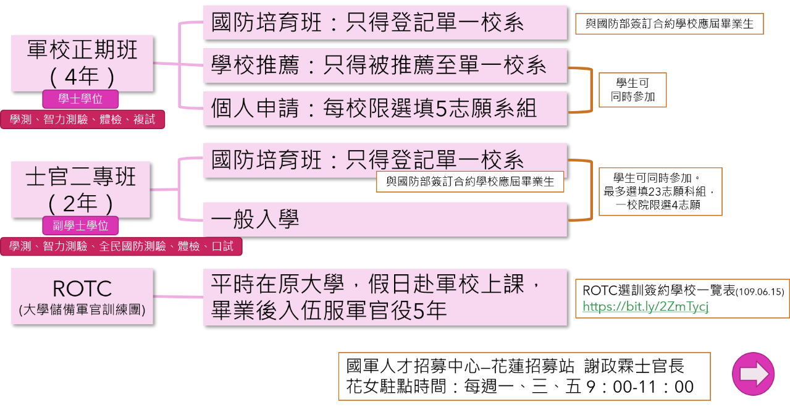

##### C. 運動績優學生大專院校升學考試 ＆ D. 國外／港澳日大陸大學申請

|管道類別 |子管道／地區 |核心資格與測驗要求 |重要說明與官方資訊 |
|:--- |:--- |:--- |:--- |
|**運動績優升學**|**甄審**|3 年內代表國家參加國際賽會獲指定成績 |免學科與術科考試，4 月中旬起由學校承辦單位初審後至 **[運動績優升學輔導網](https://lulu.ntus.edu.tw/)**報名 |
|**運動績優升學**|**甄試**|2 年內參加國際賽會或全國性運動會獲指定成績 |採計 **5 月底學科考試（國、英、數）＋ 專長術科檢定**，依加分後總分及志願序分發 |
|**運動績優升學**|**單獨招生**|運動表現優異者、曾為學校代表隊或體育班畢業生 |逕向各辦理運動獨招之大學下載簡章報名（部分採計學測 X 加上術科檢定） |
|**海外大學申請**|**美加地區**|**SAT / ACT 測驗**＋ **TOEFL / IELTS 英語檢定**＋ 高中英文成績單（GPA）與個人自傳 Essay |可透過 Common App 或社區大學轉學制（2+2）申請 |
|**海外大學申請**|**香港／日本／新加坡**|**臺灣學測成績（X）或日本留學試驗（EJU）**＋ 外語能力檢定（TOEFL/IELTS/JLPT） |多數香港與日本頂尖大學英語學程可直接憑學測頂標成績與英文面試申請（多於高三上 10～12 月截止首輪） |

  

  

### 一、課程諮詢金三角（導師 ‧ 專任輔導老師 ‧ 課諮老師）

在花女三年的選課、選組與升學探索路上，妳絕對不是孤單一人！學校建構了堅實的**「課程諮詢金三角」**陪伴妳：
1. **班級導師**：最了解妳在班上的日常學習與適應狀況，協助妳面對高中生活並提供第一線關懷。
2. **專任輔導老師（輔導室）**：協助妳運用性向測驗、興趣量表、學系探索量表等工具進行自我探索，釐清個人特質與生涯方向。
3. **課程諮詢教師（課諮老師）**：解答妳對學校課程地圖、選修課程內容、班群分流、轉組學分銜接與學習歷程檔案修課評估的所有疑惑，並協助擬定自主學習計畫！

  

---

### 二、找對人，找對地方，解決問題！

  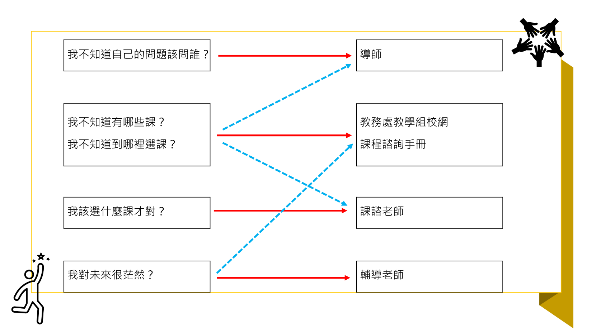

| 當妳心中有這些疑問時…… | 第一時間找誰／去哪裡最準確？ | 協同支援夥伴 |
|:--- |:--- |:--- |
|**「我不知道自己的問題該問誰？」**|**班級導師**|輔導老師、課諮老師 |
|**「我不知道學校有哪些課？不知道到哪裡選課？」**|**教務處教學組校網 ＆ 本冊《選課輔導手冊》**|班級導師、課諮老師 |
|**「我該選什麼課才對？數 A 還是數 B？要不要轉組？」**|**課程諮詢教師（課諮老師）**|教務處教學組／註冊組 |
|**「我對未來很茫然，不知道自己喜歡什麼科系？」**|**輔導室－專任輔導老師**|課諮老師、班級導師 |
---

### 三、課程說明會與課程諮詢三年規劃（高一入學 ～ 高三畢業）

  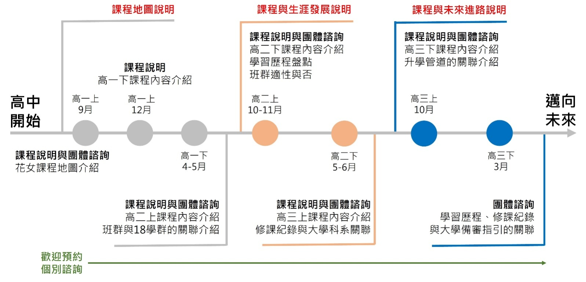

---

### 四、全學年選課重要期程表（高一 ‧ 高二 ‧ 高三）

>  註：標註「**◎**」為必選課作業；標註「****」表示可依個人需求自由選擇參加與否；實際日期依每學期教務處最新公告為準。

|月份 |學期階段 | **高一（115 入學）**| **高二（114 入學）**| **高三（113 入學）**|
|:---: |:---: |:--- |:--- |:--- |
|**8 月**|**上學期初**|新生始業輔導課程地圖說明 |— |— |
|**9 月**|**上學期初**|‧ **一上課程說明會** ‧ **◎ 選一上多元選修** ‧ **選一上彈性時間微課程** ‧ 提交自主學習計畫 |‧ **選二上彈性時間微課程** ‧ 提交自主學習計畫 |‧ **選三上彈性時間微課程** ‧ 提交自主學習計畫 |
|**10～11 月**|**上學期中**|第一次段考後修課適應檢核 |**二下課程說明會**（學習歷程盤點與班群適性檢視） |**三下課程說明會**（升學管道與選修對應） |
|**12 月**|**上學期末**|‧ **一下課程說明會** ‧ **◎ 選一下多元選修** ‧ **選一下充補／彈性微課程**|‧ **◎ 選二下多元／補強選修** ‧ **選二下充補／彈性微課程** ‧ 寒假轉組申請（11～12月） |‧ **◎ 選三下多元選修** ‧ **◎ 選三下加深加廣課程** ‧ **◎ 社會組選三下補強性選修** ‧ **選三下充補課程**|
|**3～4 月**|**下學期中**|‧ 生涯興趣量表施測與解測 ‧ **二上課程與選組說明會**|**三上課程說明會**（修課紀錄與大學科系關聯） |**團體諮詢：學習歷程、修課紀錄與大學申請備審指引**|
|**5 月**|**下學期末**|‧ **家長座談會 ＆ 選組諮詢輔導** ‧ **◎ 選組截止（自然組 A／社會組 B 及數 A／數 B）** ‧ **選二上充補／彈性微課程**|‧ **◎ 選三上多元選修** ‧ **◎ 選三上加深加廣課程** ‧ **◎ 社會組選三上補強性選修***(與加深加廣數乙混合跑班)* ‧ 暑假轉組申請（4～5月） |高三下畢業學分最後總檢核與重補修登記 |
|**6 月**|**下學期末**|**◎ 高二選課正式登記確認**|**◎ 高三選課正式登記 ＆ 轉組名單公告**|鳳凰花開・璀璨畢業  |
---

### 五、選組／轉組重要期程

1. **高一選組期程（每年 3 月 ～ 6 月）**：
   - **3 月**：大考中心興趣量表施測、新編多元性向測驗解析。
   - **4 月**：興趣量表解測、**高一選課選組說明會**、高二開課資訊公告。
   - **5 月初～5 月中**：**高一家長座談會**、**個別／小團體選組諮詢輔導**、**選組正式截止**。
   - **6 月**：高二選課登記確認。
2. **高二、高三轉組期程（每學年 2 次申請機會）**：
   - **第一學期期末（寒假轉組，高二上轉高二下）**：**11～12 月**提出轉組申請（需經導師、輔導老師、課諮老師晤談簽章與家長同意）  **1 月**公告轉組名單。
   - **第二學期期末（暑假轉組，高二下轉高三上）**：**4～5 月**提出轉組申請  **6 月**公告轉組名單。

---

### 六、花蓮女中課程諮詢團隊與線上預約連結

-  **花女課程諮詢服務站專頁**：https://www.hlgs.hlc.edu.tw/curriculum/class-consult/
-  **預約個別課程諮詢方式**：同學可於每學期選課前或平時，至**教務處教學組**、**輔導室**或透過校網「課程諮詢服務站」線上表單預約課諮老師進行一對一或小團體諮詢！

  

  

### 一、【課程疑惑篇】（Q1 ～ Q5）

<b>Q1 ～ Q5：選修沒對應到想讀科系怎麼辦？哪個學群對大考最有利？轉組會不會畢不了業？自主學習沒過怎麼辦？</b>

 

- **Q1：若到了高三才發現選修的課程與想讀的科系似乎沒有完全對應，可以尋求哪些協助？**
  - **A1**：同學可以向**輔導教師**或**課程諮詢教師**尋求協助，請老師給予具體的建議。例如：如果修課紀錄或課程學習成果無法與想要申請的科系直接對應，老師會建議同學從**「多元表現成果（含自主學習、社團、競賽、營隊）」**去呈現妳對該領域的興趣與能力；或者在高三**「學習歷程自述（學習歷程反思）」**中，真誠陳述自己從高一高二自我探索、嘗試、覺察到最終確立科系選擇的心路歷程，大學教授非常肯定懂得反思與自我覺察的學生！
- **Q2：唸哪一個學群（班群）對學生參加學測或分科測驗時最有幫助？**
  - **A2**：各班群之課程差異，是為了讓同學在學習歷程中更對準未來目標學群之需求。因此選擇哪一班群應**以個人興趣、性向與目標科系為首要考量**，而非單純以大考為唯一考量。本校對於學測與分科測驗各考科所需之「部定必修」與「加深加廣選修」皆已完整開設，只要按部就班在校認真學習，都能培養面對學測與分科測驗的堅強實力。
- **Q3：不同學群裡都有喜歡的課程或科系，該如何選擇班群？**
  - **A3**：建議選擇班群時，除了考慮自己喜歡的單一課程外，也要評估自己在該班群「其他核心加深加廣課程（例如自然組的物化生數A、社會組的歷地公探究）」是否足以勝任。對於在另一班群裡喜歡的領域，可善用每學期的**「多元選修」**或**「彈性學習時間（自主學習／微課程）」**進行跨領域探索！
- **Q4：如果志趣改變，決定轉組（轉換班群），會不會因為某部分學分不足而不能畢業？**
  - **A4**：只要提早規劃就不用擔心！轉組前請對照本手冊第貳章「**五、各班群課程差異（轉組缺少科目對照表）**」與「**六、畢業條件與修課學分檢核表**」（特別留意自然組與社會組《家政》及高二對開科目的學分落差），並向**教務處註冊組、課程諮詢教師、班級導師或輔導老師**洽詢確認補修規劃（未修習之必修科目可透過暑期補修專班完成）。
- **Q5：自主學習一定要有嗎？如果自主學習規劃表未審查通過怎麼辦？**
  - **A5**：**是的！**十二年國教新課綱明文規定，每位高中生三年間**至少需完成 18 節以上的自主學習**。若自主學習計畫書初審未通過，別擔心，學校的「自主學習審查小組」與指導老師會協助妳修訂計畫內容，輔導妳直到審查通過為止。

|圖 7-1：海洋文學營隊學員登上鏢魚船體驗（講解者為黑潮海洋文教基金會賴威任先生） |圖 7-2：柯昊錚學姊回母校提供學妹們課業輔導與陪讀服務 |
|:---: |:---: |
|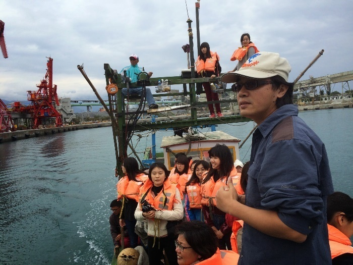 |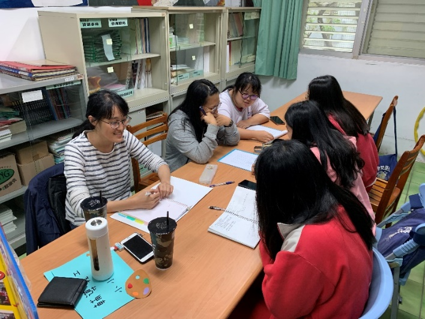 |
---

### 二、【學習歷程檔案篇】（Q1 ～ Q7）

  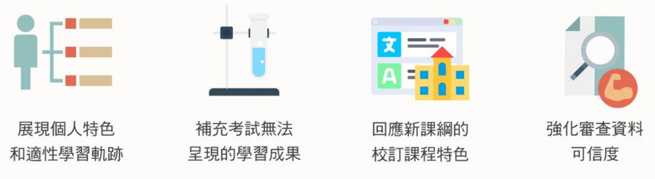

<b>Q1 ～ Q7：課程學習成果 vs 多元表現怎麼分？可以高三再一次上傳嗎？檔案大小與格式限制？轉組會影響參採嗎？</b>

 

- **Q1：若學習歷程檔案製作得不完備，可以像 108 課綱以前一樣另外製作 PDF 備審資料上傳當作申請大學的「P1」資料嗎？**
  - **A1**：目前大學申請入學仍開放「勾選學習歷程中央資料庫」或「自行上傳 PDF 檔案」雙軌並行，但使用中央資料庫勾選的資料具有**學校與任課教師認證的高可信度**，且能省下高三下重新排版趕工的大量時間。建議同學每學期按時完成上傳與認證，若對最新規定有疑問請洽詢導師、課諮老師或學習歷程工作小組。
- **Q2：哪些課程的學習成果可以上傳至「課程學習成果」？彈性學習中的微課程或自主學習成果能否列入？**
  - **A2**：
    1. **可列入「課程學習成果」**：凡**有學分且任課老師會評分**的正式課程（包含**部定必修、校訂必修、加深加廣選修、多元選修、補強性選修**），其作品經任課教師線上認證後，即可列入「課程學習成果」。
    2. **應列入「多元表現」**：**沒有學分且不評分**的時間（如**社團活動、彈性學習時間之自主學習、微課程、選手培訓**），雖然不能放進「課程學習成果」，但都可以上傳至學習歷程檔案的**「多元表現」**項目中！
- **Q3：學習歷程檔案中的「課程學習成果」和「多元表現」一定要每學期都上傳嗎？可不可以在高三時再把高一、高二的成果一併上傳？**
  - **A3**：**千萬不行把「課程學習成果」拖到高三！**依據教育部國教署作業要點，**「課程學習成果」必須在每學期規定時間內上傳並由當學期任課教師完成認證**，逾期系統關閉即無法補傳前學期的課程成果！至於「多元表現」則以高中三年內的經歷為原則，雖較具時間彈性，但仍須於每學年規定時間內勾選至多 **10 件**提交至中央資料庫。
- **Q4：每學期上傳到學習歷程檔案的作品，檔案格式與大小有規定嗎？**
  - **A4**：有的！全國統一上傳格式與容量限制如下：
    1. **文件檔案上限 4 MB**：格式限 **PDF、PNG、JPG**（1 份 4MB 的 PDF 大約可包含 15 張圖文頁面，建議轉存 PDF 前先適度壓縮圖片）。
    2. **影音檔案上限 10 MB**：格式限 **MP3、MP4**（MP3 音檔約可錄製 6 分鐘；但 10MB 的 MP4 影片在 720P 畫質下僅約 20 秒、480P 約 50 秒，因此**一般作品建議以圖文 PDF 呈現為主，或將高品質影片連結附於 PDF 內頁 QR Code／網址說明**）。
- **Q5：學習歷程檔案對升大學有什麼具體幫助？**
  - **A5**：
    1. **對學生而言**：高中三年每學期累積 3 件（共 18 件）課程學習成果、每學年 10 件（共 30 件）多元表現，高三申請大學時只需從中勾選（至多 3 件課程成果＋10 件多元表現），再專心撰寫「學習歷程自述（反思、動機、讀書計畫）」即可，大幅減輕高三下學期的備審壓力。
    2. **對大學而言**：大學教授能透過經學校認證的修課紀錄與歷程作品，看見同學在學測分數之外的真實探究能力、學習態度與長期投入熱忱。
- **Q6：在學期中將課程學習成果和多元表現陸續上傳了，期末前是否可以修正或更換檔案？**
  - **A6**：
    1. 在**校內上傳截止前（以及老師尚未完成最終認證前）**，學生皆可於校內平台修改或替換上傳的檔案；經老師認證後，每學期期末可從通過認證的作品中挑選至多 **3 件**勾選提交至中央資料庫。**注意：一旦正式完成「提交至中央資料庫」確認後，就無法再更改或抽換！**
    2. 多元表現由學生自行登錄上傳，每學年期末可從已登錄的所有多元表現中勾選至多 **10 件**提交至中央資料庫。
- **Q7：如果高二已選修物理、化學、生物（自然組），高三轉組改選修歷史、地理、公民（社會組），會不會影響申請入學學習歷程檔案的參採評比？**
  - **A7**：**不會！**大學端審查高中修課歷程時，看重的是學生的**學習態度、跨領域探索精神與表現**。若因高一高二生涯探索後重新定向而轉換班群，只要在學習歷程自述中清楚說明探索與轉向的脈絡，反而能展現妳跨領域的數理／人文底蘊，不會因此影響申請入學評比。

---

### 三、【課程諮詢篇】（Q1 ～ Q7）

<b>Q1 ～ Q7：不知道想唸什麼科系怎麼選課？導師、輔導老師、課諮老師差在哪？課諮紀錄大學看得到嗎？校訂必修不及格能畢業嗎？</b>

 

- **Q1：如果還不知道大學想要唸的科系，在高中選修哪些課程對自己比較有幫助？可以請教哪些老師？**
  - **A1**：本校的**課程諮詢教師（課諮老師）**可以協助妳認識學校課程地圖與大學十八學群的關聯；若想先了解自己的性向、人格特質與興趣方向，可結合高一施測的「新編多元性向測驗」與「大考中心興趣量表」，先找**輔導老師**討論，再由**課諮老師**協助規劃能廣泛試探興趣的多元選修與微課程。
- **Q2：學生「選課諮詢輔導內容（包含本手冊）」可以在學校哪些地方查詢？**
  - **A2**：除了本 GitHub 儲存庫（`group01-hlgs/course-selection-guide`）與互動網頁版可隨時在手機／電腦秒速查詢外，亦可於**國立花蓮女中學校首頁 「課程諮詢服務站」**（`https://www.hlgs.hlc.edu.tw/curriculum/class-consult/`）查閱全文與分章檔案。
- **Q3：如果對未來選課及想要就讀大學科系的方向仍不清楚，請問要詢問導師、輔導老師還是課程諮詢教師呢？**
  - **A3**：三位老師分工合作、隨時為妳敞開大門：
    1. **不同角色分工**：
       - **導師**：最了解班上同學個別學習狀況，可共同協助日常學習與初步諮詢。
       - **輔導老師**：提供心理測驗解析、個人特質探索與**生涯輔導**。
       - **課程諮詢教師**：以團體或個別方式提供**選修課程諮詢**、檢核學習歷程修課評估、登載課諮紀錄，並協助擬定自主學習計畫。
    2. **不同期程搭配**：在新生報到／暑期輔導起，以及每學期選課前至開學後兩週內為「重點課程諮詢時段」，由課諮教師進行小團體或個別選課諮詢；平時若對興趣、性向、升學進路有疑問，可隨時找專任輔導教師進行生涯探索，有了具體方向後再與課諮老師對接選課。
- **Q4：如果對自己的個人特質與性向為何、適合往哪個領域發展都還不清楚時，可以找誰協助？**
  - **A4**：請先帶著輔導室提供的心理測驗結果與生涯手冊，和**輔導老師、導師或家人**討論，釐清自己喜歡與擅長的領域後，再預約**課程諮詢教師**針對具體課程選擇提供建議。
- **Q5：跟課程諮詢教師所談的內容，大學端教授會有可能看到嗎？**
  - **A5**：**絕對不會，請放心暢所欲言！**課諮老師皆受過專業培訓，與同學晤談的詳細內容僅留存於學校輔導與諮詢紀錄中，**完全不會提交至全國學生學習歷程檔案中央資料庫**（系統僅會登載團體或個別諮詢的日期、地點與簡短主題類別而已）。
- **Q6：如何得知每學期應修習哪些課程？**
  - **A6**：每學期選課前，學校會由課程諮詢召集人與教務處召開**各年級課程說明會**，並透過本手冊與課程計畫書向師生及家長說明。
- **Q7：「校訂必修課程」萬一不及格，會影響畢業資格嗎？**
  - **A7**：依據十二年國教總綱與學習評量辦法規定，普通班「校訂必修（4 學分）」每一門都**必須修習**，而畢業及格門檻是與部定必修合併計算（**普通班「部定必修＋校訂必修」合計至少需 102 學分及格**，未規定單一校訂必修科目非及格不可；但**語文資優班、數理資優班之特殊需求領域校訂必修則規定至少須 85% 及格**，美術班為部定+校訂合計至少 128 學分及格）。當然，校訂必修《洄瀾之欣》與《職業探究與報導》產出的專題作品是極佳的學習歷程成果，大家一定要認真投入喔！

---

### 四、【升學進路篇】（Q1 ～ Q4）

|升學管道 | 誰最適合這個管道？（自我檢核重點） |
|:--- |:--- |
|**Q1：誰適合「特殊選才」？**|1. **具特殊專長、屬於偏才型的學生**：興趣非常明確且表現突出，在特定學科或多元表現有亮眼實績。 2. **具特殊經歷者**：如國際／全國學科或專長競賽獲獎、取得高階專業證照、實驗教育成果或特定扶弱條件之學生。 |
|**Q2：誰具有「繁星推薦」資格？**|1. **全程就讀花蓮女中且中途未轉學**之應屆畢業生。 2. 須先報考**學測**（及校系要求之英聽／術科），且**高一至高二各學期學業總平均成績之「全校排名百分比」達到前 20%、前 30%、前 40% 或前 50%**，即可參與校內繁星推薦撕榜與評比！ |
|**Q3：誰適合「申請入學」？**|1. 清楚自己的能力與興趣、知道大學想就讀哪些學群與科系的同學。 2. 學測成績（X）通過校系一階篩選標準，且平時穩健累積**學習歷程檔案（P1）**、願意展現口語面試或實作表現（P2）的同學。 |
|**Q4：誰適合「分發入學（分科測驗）」？**|1. 學測未發揮最佳實力，或申請入學未錄取最理想校系，願意堅持到底再拚一次的同學。 2. **特定專業科目（如數甲、數乙、物理、化學、生物、歷史、地理、公民）實力突出**，且與目標科系採計加權科目高度重疊者。 3. 能不受周遭已錄取同學影響，高三下學期依然能定下心來專注衝刺的人！ |
---

### 五、手冊發行資訊與編輯團隊（115 學年度多風格數位改版）

  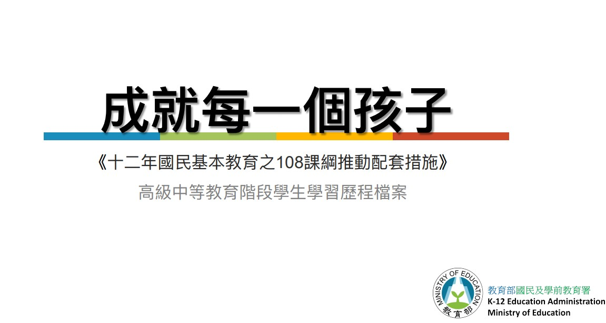

|欄位項目 |內容資訊 |欄位項目 |內容資訊 |
|:--- |:--- |:--- |:--- |
|**書名**|**國立花蓮女子高級中學 選課輔導手冊（115 學年度數位互動改版）**|**發行者**|**國立花蓮女子高級中學（National Hualien Girls' Senior High School）**|
|**發行人**|**詹滿福 校長**|**學校地址**|**970 花蓮縣花蓮市菁華街 2 號**|
|**編輯委員**|**張家誠、陳怡伶、林毓淵、林家煜、張珮郁、朱柏亘、黃敬云、林廷諭、陳玉時、張書衡**|**聯絡電話**|**(03) 832-1202**／ 傳真：(03) 833-0251 |
|**執行編輯**|**黃文琴**|**課程基準**|**113(高三)、114(高二)、115(高一) 學年度報部核定課程計畫書 ＆ 115 選課輔導手冊母檔**|
|**協助編輯**|**林佩蓉、杜宜庭**|**學校官網**|https://www.hlgs.hlc.edu.tw/curriculum/class-consult/ |
|**排版整理**|**張家誠**（數位多主題 README 與 經典圖鑑風版協作升級） |**GitHub 專案**|https://github.com/group01-hlgs/course-selection-guide |

  

   <b>國立花蓮女子高級中學 教務處教學組 ‧ 課程諮詢教師團隊 敬編</b> ｜ 點擊頂部按鈕可隨時切換 <b> 洄瀾太平洋 /  經典圖鑑風(古籍典藏) /  Y2K 丹寧銀灰 /  文青獨立雜誌 /  縱谷松針森系 /  極簡黑白</b> 六大現代風格！

