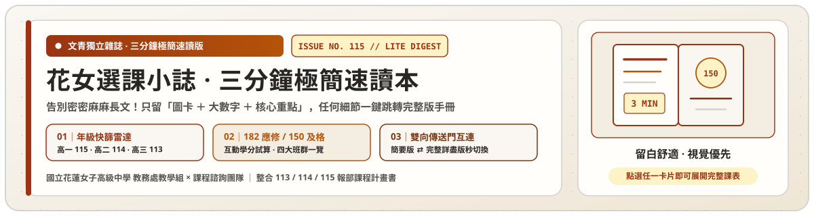
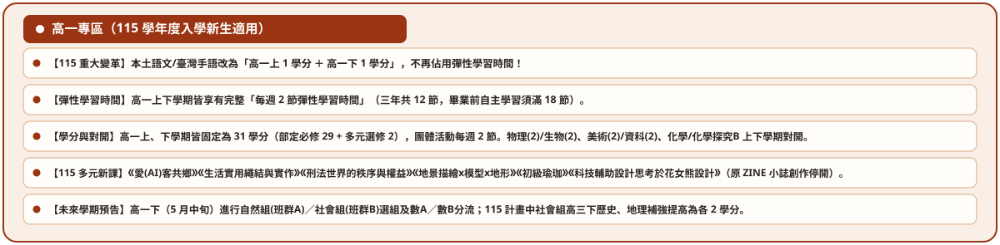
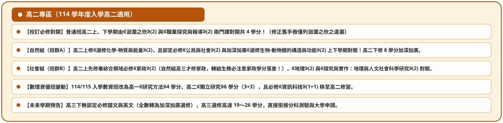
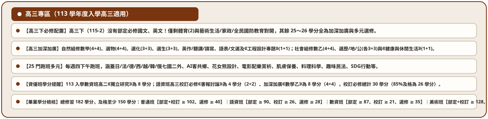
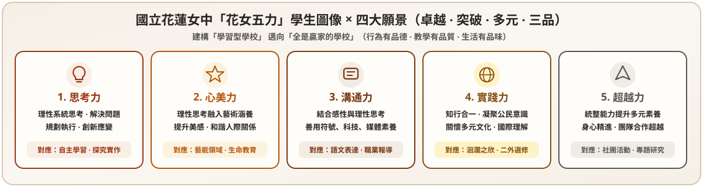
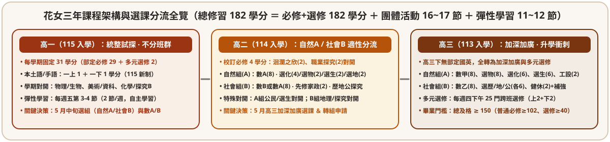

<!-- 動態深淺色自適應 SVG 主題橫幅 (100% 本地創作純向量 SVG，零外部圖源、零 Emoji) -->
<picture>
  <source media="(prefers-color-scheme: dark)" srcset="assets/banner-zine-lite-dark.svg" />
  <source media="(prefers-color-scheme: light)" srcset="assets/banner-zine-lite.svg" />
  
</picture>

 

<!-- 頂部雙版本 × 雙平台互連導覽列 -->

  
  
  

> **歡迎翻閱《花女選課小誌 ‧ 三分鐘文青極簡速讀版》！**
> 覺得 1,100 行的完整版手冊文字太多？這裡只濃縮**最核心的純向量 SVG 圖卡、關鍵大數字與三句話重點**。想查閱完整六學期課表或 30 門選修清單時，點擊每章底部的「**雙向傳送門**」即可一秒跳轉至 [完整詳盡版 README (`README.md`)](README.md) 或 [互動網頁版 (`lite.html` / `index.html`)](https://group01-hlgs.github.io/course-selection-guide/lite.html)！

<table>
  <thead>
    <tr>
      <th width="50%" align="left"> 七大跨頁速讀目錄（點擊直達本章）</th>
      <th width="50%" align="left"> 雙版本 ‧ 雙平台任意門（HTML ⇄ README 互連）</th>
    </tr>
  </thead>
  <tbody>
    <tr>
      <td valign="top">
        <ul>
          <li><b><a href="#spread-00">Spread 00｜三屆選課快篩雷達</a></b>（<a href="#g1-radar">高一115</a> ‧ <a href="#g2-radar">高二114</a> ‧ <a href="#g3-radar">高三113</a>）</li>
          <li><b><a href="#spread-01">Spread 01｜關於花女 ‧ 花女五力與校訂必修</a></b></li>
          <li><b><a href="#spread-02">Spread 02｜畢業門檻 150 學分 ‧ 四班群速覽</a></b></li>
          <li><b><a href="#spread-03">Spread 03｜選組(自然A/社會B) × 數A數B × 彈學</a></b></li>
          <li><b><a href="#spread-04">Spread 04｜生涯探索金三角 × 興趣六碼</a></b></li>
          <li><b><a href="#spread-05">Spread 05｜學習歷程 (6+10→3+1) × 四大升學管道</a></b></li>
          <li><b><a href="#spread-06">Spread 06 &amp; 07｜課諮金三角 × 7 大熱門 Q&amp;A 一句話速答</a></b></li>
        </ul>
      </td>
      <td valign="top">
        <ul>
          <li><b>文青簡要網頁版</b>：<a href="https://group01-hlgs.github.io/course-selection-guide/lite.html"><code>lite.html</code>（支援年級快篩標籤＋學分試算＋6主題）</a></li>
          <li><b>完整詳盡網頁版</b>：<a href="https://group01-hlgs.github.io/course-selection-guide/"><code>index.html</code>（含完整六學期課表＋30門多元選修＋34社團）</a></li>
          <li><b>完整詳盡 GitHub 版</b>：<a href="README.md"><code>README.md</code>（整合 113/114/115 三份報部課程計畫書）</a></li>
          <li><b>6 大主題 README 快速切換</b>：<a href="README-zine.md">文青雜誌</a> ‧ <a href="README-ocean.md">洄瀾太平洋</a> ‧ <a href="README-atlas.md">經典圖鑑</a> ‧ <a href="README-denim.md">丹寧銀灰</a> ‧ <a href="README-pine.md">松針森系</a> ‧ <a href="README-mono.md">極簡黑白</a></li>
        </ul>
      </td>
    </tr>
  </tbody>
</table>

## Spread 00｜115 三屆選課快篩雷達（先看妳是哪一屆！）

| 【高一 115入學】當學期必看 | 【高二 114入學】當學期必看 | 【高三 113入學】當學期必看 |
| :---: | :---: | :---: |
|  |  |  |
| 1. 本土語改 **`1+1` 學年課**（不與彈學對開） 2. 彈學六學期皆 **每週 2 節**（自主學習滿18節） 3. 四班群高一每學期固定 **31 學分** [→ 查高一 30 門多元選修](README.md#ch3-2) ｜ [→ 網頁版](https://group01-hlgs.github.io/course-selection-guide/#g1-radar) | 1. 校訂必修《洄瀾之欣》(2) 與《職探》(2) **對開** 2. 自然 A《公民/選生》對開；社會 B **高二上修家政(2)** 3. 數資班《研究方法》(4)、《獨立研究》(6) [→ 查高二班群課表](README.md#ch2-4) ｜ [→ 轉組提醒](README.md#ch2-5) | 1. 高三下**無部定國英**（全轉加深加廣） 2. 週四下午 **25 門跨班多元選修** 3. 畢業門檻 **150 學分**（普通班必修≥102、選修≥40） [→ 查畢業檢核表](README.md#ch2-6) ｜ [→ 升學時程](README.md#ch5-2) |

> **跨屆 4 大核心差異速記**：**(1) 本土語**：113/114 為單學期 2 學分與彈學對開 → **115 改一上1＋一下1**；**(2) 高一總學分**：113/114 為 30/32 → **115 固定 31/31**；**(3) 社會組高三歷地補強**：113/114 為 1+1 → **115 改 2+2**；**(4) 數資班資訊科技**：113 高一修 → **114/115 移至高二修**。

  <a href="#top">[↑ 回頂部]</a> ‧
  <a href="README.md#radar">[⇄ 展開完整版「跨屆10大變動總表」]</a> ‧
  <a href="https://group01-hlgs.github.io/course-selection-guide/lite.html#spread-00">[↗ 簡要網頁版]</a> ‧
  <a href="https://group01-hlgs.github.io/course-selection-guide/#card-sec-radar">[↗ 完整網頁版]</a> ‧
  <a href="#spread-01">[下一頁：Spread 01 →]</a>

## Spread 01｜關於花女 ‧ 花女五力與校訂必修

  

- **普通班高二校訂必修（共 4 學分，上下學期對開）**：
  1. **《洄瀾之欣》(2 學分)**：結合**海洋產業文化、海岸地形、海洋資源**三大模組，以 PBL 專題實察培養花女五力（[→ 對照高二課表](README.md#ch2-4)）。
  2. **《職業探究與報導》(2 學分)**：結合生涯探索、職人田野訪談與紀實寫作，直接產出高二亮點「課程學習成果」（[→ 對照高二雷達](README.md#g2-radar)）。
- **特殊班校訂必修**：**語資班 30 學分**（含論文寫作、獨立研究、書報討論）｜**數資班 24 學分**（含研究方法、獨立研究、數學專題）｜**美術班特需 8 學分＋專長 60 學分**。

  
   ▲ 校訂必修《洄瀾之欣》課程架構與學生五力雷達圖

| 圖 1-1：《洄瀾之欣》110-2 票選得獎作品—手繪地圖 | 圖 1-2：《洄瀾之欣》110-2 票選得獎作品—地景報導 |
| :---: | :---: |
|  |  |

  <a href="#spread-00">[← 上一頁]</a> ‧
  <a href="#top">[↑ 回頂部]</a> ‧
  <a href="README.md#ch1">[⇄ 展開完整版「第壹章：願景與四班群校必總表」]</a> ‧
  <a href="https://group01-hlgs.github.io/course-selection-guide/lite.html#spread-01">[↗ 簡要網頁版]</a> ‧
  <a href="https://group01-hlgs.github.io/course-selection-guide/#card-sec-ch1">[↗ 完整網頁版]</a> ‧
  <a href="#spread-02">[下一頁：Spread 02 →]</a>

## Spread 02｜畢業門檻 150 學分 ‧ 三年課程架構與四班群速覽

  

| 畢業檢核樣態（共 3 種樣態） | 適用班別 | 應修總分 | 畢業總門檻 | ① 必修及格門檻 | ② 選修及格門檻 | 完整課表傳送門 |
| :--- | :--- | :---: | :---: | :--- | :--- | :---: |
| **樣態一｜普通班（自然/社會同掛）** | **自然班群 A ‧ 社會班群 B** | **182** | **≥ 150** | 部定(118)＋校訂(4) **合併 ≥ 102** | **選修(60) ≥ 40** | [完整課表 →](README.md#ch2-4) |
| **樣態二｜學術資優班（語資/數資同掛）** | **語文資優班** | **182** | **≥ 150** | 部定一般 ≥ **90**(80%) ‧ 特需 ≥ **26**(85%) | **選修(40) ≥ 28**(70%) | [語資課表 →](README.md#ch2-4) |
| **樣態二｜學術資優班（語資/數資同掛）** | **數理資優班** | **182** | **≥ 150** | 部定一般 ≥ **87**(80%) ‧ 特需 ≥ **21**(85%) | **選修(50) ≥ 35**(70%) | [數資課表 →](README.md#ch2-4) |
| **樣態三｜藝才資優班（美術獨立樣態）** | **美術資優班** | **182** | **≥ 150** | 部定(86+專長60)＋特需(8) **合併 ≥ 128** | **選修(28) ≥ 14**(50%) | [美術課表 →](README.md#ch2-4) |

> **互動試算與轉組必看**：想輸入分數自動檢核是否達標？請點選 [**線上畢業學分即時試算器 (`lite.html#credit-calculator`)**](https://group01-hlgs.github.io/course-selection-guide/lite.html#credit-calculator)！高二若考慮轉組，請務必留意**社會組高二上先修《家政》(2)、自然組高三才修《家政》(2)**（[→ 詳見轉組學分對照](README.md#ch2-5)）。

  <a href="#spread-01">[← 上一頁]</a> ‧
  <a href="#top">[↑ 回頂部]</a> ‧
  <a href="README.md#ch2">[⇄ 展開完整版「第貳章：六學期完整學分表與轉組指南」]</a> ‧
  <a href="https://group01-hlgs.github.io/course-selection-guide/lite.html#spread-02">[↗ 簡要網頁版]</a> ‧
  <a href="https://group01-hlgs.github.io/course-selection-guide/#card-sec-ch2">[↗ 完整網頁版]</a> ‧
  <a href="#spread-03">[下一頁：Spread 03 →]</a>

## Spread 03｜選組（自然A / 社會B）× 數A數B × 彈性自主學習

| 決策維度 | 班群 A（自然組） | 班群 B（社會組） | 深度清單傳送門 |
| :--- | :--- | :--- | :--- |
| **高二／高三數學** | 高二 **數 A (4+4)** → 高三 **數甲 (4+4)** | 高二 **數 B 或 數 A 跑班 (4+4)** → 高三 **數乙/補強** | [數A/數B單元對照 →](README.md#ch3-1) |
| **加深加廣選修** | 選修物(10)、化(8)、生(8)、地科(2)、工程設計(2) | 歷探/地探/公探與專題(各8)、國英加深、數乙(8) | [分科測驗Y範圍 →](README.md#ch5-2) |
| **跨班多元選修** | 高一 **30 門**（含 7 國二外與 115 新增《愛(AI)客共鄉》《花女熊設計》等 6 門）、高三週四下午 **25 門** | 同左，一上/一下各 2 學分（不得重複修習同門） | [30門完整清單 →](README.md#ch3-2) |
| **彈學與 34 社團** | **每週五第 3-4 節彈性學習**（畢業前**自主學習必滿 18 節**） | **每週三第 5-7 節班會與 34 個社團** | [一週課表與社團 →](README.md#ch3-3) |

  <a href="#spread-02">[← 上一頁]</a> ‧
  <a href="#top">[↑ 回頂部]</a> ‧
  <a href="README.md#ch3">[⇄ 展開完整版「第參章：數A/B對照、30門選修與34社團」]</a> ‧
  <a href="https://group01-hlgs.github.io/course-selection-guide/lite.html#spread-03">[↗ 簡要網頁版]</a> ‧
  <a href="https://group01-hlgs.github.io/course-selection-guide/#card-sec-ch3">[↗ 完整網頁版]</a> ‧
  <a href="#spread-04">[下一頁：Spread 04 →]</a>

## Spread 04｜生涯探索金三角 × 興趣六碼 × 十八學群

| 圖 4-1：Swain 生涯規劃金三角 | 圖 4-2：Holland 興趣六碼（RIASEC）與大學十八學群對照 |
| :---: | :---: |
|  |  |
| **自我認識 × 教育職業資料 × 環境因素** | **R 實用 / I 研究**（理工生醫）‧ **A 藝術 / S 社會 / E 企業 / C 事務**（文史法政商管設計） |

- **三大性向組合速判**：**理工傾向**（數字＋圖形＋機械/空間）｜**文科傾向**（語文＋中文＋英文）｜**商管傾向**（語文＋數字＋知覺速度）。
- **對應選課**：查閱完整 [**大學 18 學群 × 高中班群 × 建議數學版本總表 (`README.md#ch4-3`)**](README.md#ch4-3) 與 [**15 大升學查詢網站 (`README.md#ch4-3`)**](README.md#ch4-3)。

  <a href="#spread-03">[← 上一頁]</a> ‧
  <a href="#top">[↑ 回頂部]</a> ‧
  <a href="README.md#ch4">[⇄ 展開完整版「第肆章：性向測驗與18學群完整總表」]</a> ‧
  <a href="https://group01-hlgs.github.io/course-selection-guide/lite.html#spread-04">[↗ 簡要網頁版]</a> ‧
  <a href="https://group01-hlgs.github.io/course-selection-guide/#card-sec-ch4">[↗ 完整網頁版]</a> ‧
  <a href="#spread-05">[下一頁：Spread 05 →]</a>

## Spread 05｜學習歷程黃金公式 `6 + 10 → 3 + 1` × 四大升學管道

> **學習歷程檔案（P1）一句話公式：`每學年勾選 6 件課程成果 ＋ 10 件多元表現 → 高三申請大學勾選 3 件 ＋ 1 份自述`**
> - **課程學習成果**（有學分之必選修作品，PDF ≤ 4MB、影音 ≤ 10MB）：每學期經任課老師認證後**勾選 3 件（每學年 6 件）**提交中央資料庫；**逾期絕無法補傳前學期成果**！
> - **多元表現**（自主學習、社團、微課程、競賽、檢定）：每學年勾選至多 **10 件**提交中央資料庫。

| 升學管道 | 辦理時間 | 一句話核心規則與志願上限 | 詳情連結 |
| :--- | :---: | :--- | :---: |
| **1. 特殊選才** | 高三上 10–12月 | **不看學測**！招收具特殊專長、競賽獲獎或偏才學生，各大學獨立招生 | [詳見完整版 →](README.md#ch5-2) |
| **2. 繁星推薦** | 高三下 3月 | 全程就讀花女、在校排名前 **20%～50%** 且過學測檢定，每人限推薦 **1 校 1 學群** | [詳見完整版 →](README.md#ch5-2) |
| **3. 申請入學 / 四技** | 高三下 3–6月 | 一階看學測(X)，二階看 **學習歷程(P1)＋面試筆試(P2)**；一般大學 **6 志願**＋四技 **6 志願** | [詳見完整版 →](README.md#ch5-2) |
| **4. 分發入學** | 高三下 7–8月 | 採計 **學測(X)部分考科 ＋ 7月分科測驗(Y)** 加權分發（不看學習歷程），可填 **100 志願** | [詳見完整版 →](README.md#ch5-2) |

  <a href="#spread-04">[← 上一頁]</a> ‧
  <a href="#top">[↑ 回頂部]</a> ‧
  <a href="README.md#ch5">[⇄ 展開完整版「第伍章：認證7步驟、考科範圍與警大軍校海外管道」]</a> ‧
  <a href="https://group01-hlgs.github.io/course-selection-guide/lite.html#spread-05">[↗ 簡要網頁版]</a> ‧
  <a href="https://group01-hlgs.github.io/course-selection-guide/#card-sec-ch5">[↗ 完整網頁版]</a> ‧
  <a href="#spread-06">[下一頁：Spread 06 &amp; 07 →]</a>

## Spread 06 & 07｜課諮金三角 × 選課時程 × 7 大熱門 Q&A 一句話速答

- **課諮金三角找誰問？** 日常適應找 **班級導師** ｜ 性向興趣與科系迷惘找 **輔導室專任輔導老師** ｜ 選課、選組轉組、自主學習與學習歷程修課評估找 **課程諮詢教師**（[→ 全學年選課與寒暑假轉組期程表](README.md#ch6-4)）。
- **學長姐最常問的 7 大問題（一句話速答）**：
  1. **高三發現選修沒對應到想讀科系怎麼辦？** → 用「多元表現（自主學習/微課程）」與「學習歷程自述」展現探索脈絡，教授極重視反思力（[詳解](README.md#ch7-1)）。
  2. **轉組會不會學分不夠畢不了業？** → 不會！只要提早對照《家政》(2) 與高二對開科目差異並安排跑班或暑期重補修即可（[詳解](README.md#ch2-5)）。
  3. **自主學習一定要做嗎？** → **必做！** 畢業前至少須完成 **18 節**自主學習（[詳解](README.md#ch7-1)）。
  4. **微課程與自主學習能放進「課程學習成果」嗎？** → 不行，無學分項目請放進「**多元表現**」；有學分且老師評分的課才放「課程學習成果」（[詳解](README.md#ch7-2)）。
  5. **課程學習成果可以高三再一次補傳嗎？** → **絕對不行！** 必須在當學期期限內上傳並經任課教師認證，逾期系統關閉無法補傳（[詳解](README.md#ch7-2)）。
  6. **跟課諮老師聊的內容，大學教授看得到嗎？** → **完全看不到！** 中央資料庫僅登載諮詢日期與類別，談話內容絕對保密（[詳解](README.md#ch7-3)）。
  7. **校訂必修萬一不及格能畢業嗎？** → 普通班校訂必修(4)與部定必修(118)合併計算及格達 **102 學分**即可；但語資/數資特需必修須達 **85% 及格**（[詳解](README.md#ch7-3)）。

  <a href="#spread-05">[← 上一頁]</a> ‧
  <a href="#top">[↑ 回頂部]</a> ‧
  <a href="README.md#ch6">[⇄ 展開完整版「第陸章：課諮期程」]</a> ‧
  <a href="README.md#ch7">[⇄ 展開完整版「第柒章：23問完整解答」]</a> ‧
  <a href="https://group01-hlgs.github.io/course-selection-guide/lite.html#spread-06">[↗ 簡要網頁版]</a> ‧
  <a href="https://group01-hlgs.github.io/course-selection-guide/#card-sec-ch7">[↗ 完整網頁版]</a>

